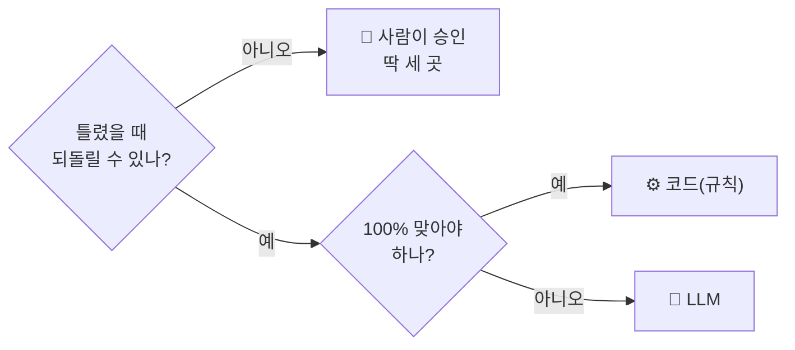
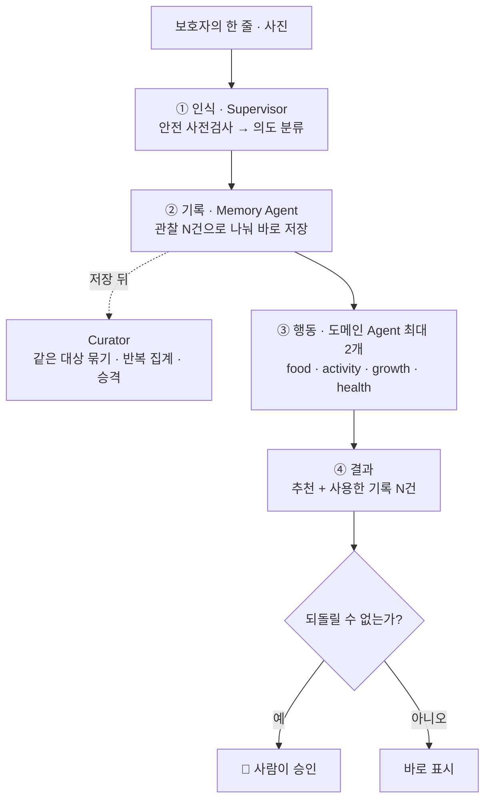
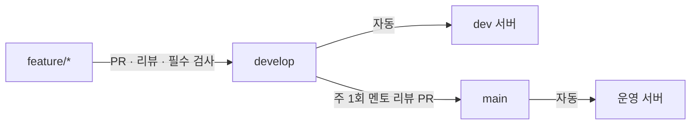
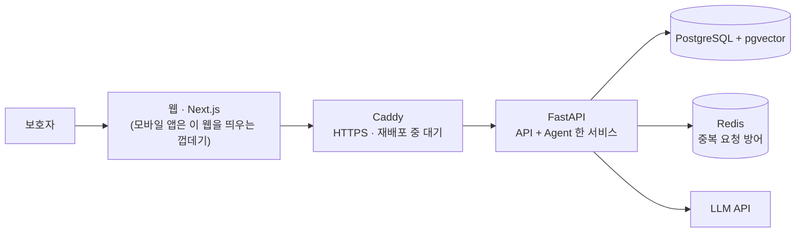

<div align="center">

# 아이캐치

**육아를 가장 많이 아는 AI가 아니라, 우리 아이를 가장 오래 알아온 AI**

<a href="https://play.google.com/store/apps/details?id=kr.ai.icatch"></a>

[웹에서 바로 쓰기](https://icatch.ai.kr) · [소개 영상 (42초)](https://youtu.be/EAYOg7bfxaI) · [개발 문서](https://kakaotechcampus-4.github.io/ktc4-pusan-3/) · [API 문서](https://api.icatch.ai.kr/docs)

| ① 한 줄 남기면 | ② 나눠서 저장하고 | ③ 근거와 함께 추천하고 | ④ 중요한 것만 묻습니다 |
| :---: | :---: | :---: | :---: |
|  |  |  |  |

<sub>화면은 가짜 데이터로 찍었습니다 · 카카오테크 캠퍼스 4기 2단계 · 부산대 3팀</sub>

</div>

<!-- 시연 영상(제출물)이 올라오면 위 링크 줄의 "소개 영상" 뒤에 시연 영상 링크를 더한다 -->

## 왜 만들었나

부족한 것은 정보가 아니라 **연결**이라고 봤습니다.

| | 지금 보호자는 | 아이캐치는 |
| :---: | --- | --- |
| **정보** | 알림장 · 일정 · 식사 · 아이의 반응이 흩어져 있다 | 한 줄과 사진을 받아 아이의 기억으로 쌓는다 |
| **연결** | 필요할 때마다 직접 찾아서 잇는다 | 쌓인 기억을 근거로 대신 잇는다 |
| **결정** | 지금 무엇이 중요한지, 다음에 뭘 할지 혼자 정한다 | 다음에 할 일을 준비해 두고 확인만 받는다 |
| **습관** | 육아 앱을 쓰려면 따로 정리해야 한다 | 새 습관이 필요 없다. 가족에게 하던 그 한 줄이면 된다 |

<div align="center">
<a href="https://youtu.be/EAYOg7bfxaI"></a>
<br><sub>▶ 소개 영상 (42초)</sub>
</div>

## 무엇을 하나

| 사진으로 적기 | 캘린더 | 기록이 없을 때 |
| :---: | :---: | :---: |
|  |  |  |
| 알림장 · 식단표를 읽어<br>일정과 준비물로 정리 | 승인한 일정과<br>그날의 기록을 날짜별로 | 맞춤인 척하지 않고<br>일반 추천이라고 표시 |

| 기능 | 한 줄로 |
| --- | --- |
| **한 줄 기록** | "저녁에 계란말이 또 먹었어, 어젯밤엔 기침 몇 번 했어" → 식사 기록 1건 + 건강 기록 1건 |
| **사진으로 적기** | 읽은 내용을 먼저 보여 주고, 확인한 것만 저장한다 |
| **근거가 달린 추천** | 식사 · 놀이 · 교육에서 다음 할 일을 제안하고, 어떤 기록 몇 건을 썼는지 보여 준다 |
| **기록 고치기** | "이번만 그랬어요" · "잘못된 기록" 으로 고치면 기억이 바뀐다 |

## AI 에게 맡기지 않은 것

기능을 붙일 때마다 "이 일을 누가 하는가" 부터 정했습니다. 질문은 두 개입니다.



| 누가 | 무엇을 | 예를 들면 |
| :---: | --- | --- |
| 🙋<br>**사람** | 캘린더에 넣기 · 건강과 알레르기 기록 확정 · 대화로 지울 때의 삭제 확정 | Agent 는 일정 초안까지만 만들고, 승인 전에는 저장하지 않는다 |
| ⚙️<br>**코드** | 알레르기 필터, 날짜 · 나이 계산, 일정 충돌, 기억의 승격, 추천 근거의 순서 | 알레르기 조회에 실패하면 "없음" 으로 넘기지 않고 추천 없이 닫는다 |
| 🤖<br>**LLM** | 한 줄에서 관찰 뽑기, 의도 분류, 식사 · 놀이 · 교육 후보 만들기 | "땅콩 알레르기 있어" 라고 말해도 저장하지 않고 직접 입력 화면으로 안내한다 |

> [!IMPORTANT]
> 진단하지 않습니다. 한 번의 관찰로 아이의 성향을 확정하지 않습니다. 근거가 없으면 일반 추천이라고 밝힙니다.

→ 규칙 전체: [CLAUDE.md §2 · §3](CLAUDE.md) · 기록 저장에는 왜 확인을 받지 않는가: [설계 결정 §7](https://kakaotechcampus-4.github.io/ktc4-pusan-3/overview/decisions-v1/)

## 어떻게 움직이나



| 이렇게 만들었다 | 왜 |
| --- | --- |
| **저장이 검색보다 먼저** | 방금 저장한 기록이 같은 요청의 추천 근거로 잡혀야 한다. 그래서 백엔드와 AI 를 한 서비스로 묶었다 |
| **20초를 넘기면 부분 결과** | Agent 하나가 늦거나 실패해도 끝난 쪽은 먼저 보여 준다 |
| **성향은 규칙이 올린다** | 기억은 `candidate` 로 시작하고 반복 집계를 거쳐야 `confirmed` 가 된다. LLM 은 이 상태를 쓰지 못한다 |

→ Agent 별 설계 · 프롬프트 · 측정: [개발 문서 사이트](https://kakaotechcampus-4.github.io/ktc4-pusan-3/)

## 만들면서 부딪힌 것

| 부딪힌 것 | 원인 | 한 일 | 결과 |
| --- | --- | --- | --- |
| 다시 누른 한 줄이 **두 번 저장**된다 | 저장은 됐는데 응답만 사라졌다 | `Idempotency-Key` 를 Redis 에 기억. Redis 가 죽으면 메모리로 넘기지 않고 503 | 같은 키 10번 → 저장 1건 |
| 같은 키가 **동시에** 오면 못 막는다 | 키 읽기와 쓰기가 따로였다 (워커 2개 실험에서 발견) | `SET NX` 한 번으로 합쳤다 | 동시 8개 × 300번, 중복 0 |
| **재배포** 중 요청이 502, 돌던 요청은 사라진다 | 컨테이너가 한 번에 하나만 뜬다 | 돌던 요청은 끝내고 내려가고, 새 요청은 프록시가 붙잡는다 | 110초 < 120초 < 150초로 맞물림 |
| 계란과 달걀을 **다른 것**으로 본다 | 임베딩 유사도가 뜻이 아니라 글자를 따라갔다 (0.20) | "같은 대상인가" 만 묻는 LLM 판정 | 유사도는 후보 추리기에만 |
| 긴 입력에서 **출력이 잘린다** | 1,000자부터 Supervisor 출력이 상한에 걸렸다 | 길이별로 재서 500자로 | 긴 글은 사진 읽기로 |

→ 계기 · 비교 · 대가까지: [설계 결정 9개](https://kakaotechcampus-4.github.io/ktc4-pusan-3/overview/decisions-v1/) · [워커 2개로 돌려 본 기록](https://kakaotechcampus-4.github.io/ktc4-pusan-3/ops/workers-2-check-v1/)

## 숫자로 본 품질

<table>
<tr>
<td align="center" width="25%"><h3>8 / 10</h3><b>기획 때 정한 시나리오</b><br><sub>실제 모델 · 3회 모두 통과해야 통과</sub></td>
<td align="center" width="25%"><h3>0건</h3><b>절대 규칙 위반</b><br><sub>147 run 을 코드로 판정</sub></td>
<td align="center" width="25%"><h3>39 / 40</h3><b>장애 점검</b><br><sub>부품 10 × 장애 4 · make test 마다</sub></td>
<td align="center" width="25%"><h3>178 / 178</h3><b>급식표 메뉴 읽기</b><br><sub>사람이 확정한 정답 1장 · 1회</sub></td>
</tr>
</table>

→ 실패한 2개의 원인: [기준선 결과](eval/results/2026-11-10.md) · 평가를 짠 방법: [eval 문서](https://kakaotechcampus-4.github.io/ktc4-pusan-3/eval/eval-v1/) · 남은 1칸: [장애 점검표](eval/faults.md)

> [!NOTE]
> **아직 못 한 것**
> - 서버는 한 대, 워커는 1개입니다. 상태를 DB 로 옮겨 늘릴 준비까지만 했습니다.
> - 10개 시나리오 중 2개가 통과하지 못했습니다 — 기록과 요청이 섞인 한 줄, 되묻기 답 이어받기.
> - 추천 카드의 채택 · 평가는 아직 아이의 성향에 반영되지 않습니다.
> - 복약 기록은 스토어 정책 때문에 닫아 두었고, Health Agent 는 추천 없이 기록과 안내만 합니다.

## 실행 · 테스트 · 배포

필요한 것: Docker · Python 3.12 + [uv](https://docs.astral.sh/uv/) · Node + pnpm

```bash
git clone https://github.com/kakaotechcampus-4/ktc4-pusan-3.git && cd ktc4-pusan-3

make db-up                                   # PostgreSQL(pgvector) + Redis
cp apps/api/.env.example apps/api/.env       # 모델 키 등을 채운다
make install && make db-migrate && make dev  # API → http://localhost:8000/docs

cp apps/web/.env.example apps/web/.env.local # 다른 터미널에서
make web-install && make web-dev             # 웹 → http://localhost:3000
```

백엔드 없이 화면만 보려면 `apps/web/.env.local` 에서 `NEXT_PUBLIC_API_MOCKING=enabled` 로 바꿉니다.

| 무엇을 검사하나 | 명령 | CI |
| --- | --- | :---: |
| API 단위 · 통합 · 장애 점검 | `make test` | [](https://github.com/kakaotechcampus-4/ktc4-pusan-3/actions/workflows/ci-api.yml) |
| 웹 단위 · 화면 규칙 e2e | `make web-test` · `make web-e2e` | [](https://github.com/kakaotechcampus-4/ktc4-pusan-3/actions/workflows/ci-web.yml) |
| 웹 ↔ 서버 계약 | `make web-contract` | [](https://github.com/kakaotechcampus-4/ktc4-pusan-3/actions/workflows/ci-contract.yml) |
| 실서버 e2e | `make web-e2e-live` | [](https://github.com/kakaotechcampus-4/ktc4-pusan-3/actions/workflows/ci-e2e-live.yml) |
| AI 품질 (실제 모델) | `make eval` | 손으로 돌린다 |



→ [배포 문서](https://kakaotechcampus-4.github.io/ktc4-pusan-3/ops/deploy-v1/)

## 무엇으로 만들었나

<div align="center">


</div>



| 고른 것 | 왜 |
| --- | --- |
| 백엔드와 AI 를 **한 서비스**로 | 저장이 검색보다 먼저여야 한다. 나누면 그 경로마다 네트워크 왕복이 생긴다 |
| 모바일은 **웹뷰 껍데기** | 화면이 두 벌이 되면 절대 규칙도 두 곳에서 지켜야 한다 |
| 벡터 DB 를 따로 두지 않고 **PostgreSQL 한 곳** | 여섯 명이 10주에 운영할 인프라는 적을수록 좋다 |

## 팀

<table>
<tr>
<td align="center" width="16%"><a href="https://github.com/jjaa0803"><br><b>박재형</b></a><br><sub>PM · 정책<br>API 일부</sub></td>
<td align="center" width="16%"><a href="https://github.com/tomchaccom"><br><b>김명성</b></a><br><sub>백엔드 · DB<br>배포</sub></td>
<td align="center" width="16%"><a href="https://github.com/nnhhlee"><br><b>이시하</b></a><br><sub>AI Agent<br>Supervisor · Memory 외</sub></td>
<td align="center" width="16%"><a href="https://github.com/03leedo"><br><b>이도헌</b></a><br><sub>AI Agent (Activity)<br>평가</sub></td>
<td align="center" width="16%"><a href="https://github.com/Hyeonsik-0"><br><b>오현식</b></a><br><sub>API<br>평가</sub></td>
<td align="center" width="16%"><a href="https://github.com/koty08"><br><b>고태영</b></a><br><sub>웹<br>모바일</sub></td>
</tr>
</table>

커밋 3,577개 · 머지된 PR 529개 · 멘토 리뷰 7회. 일하는 규칙은 [CONTRIBUTING.md](CONTRIBUTING.md)에, 여섯 명과 AI 코딩 도구가 함께 읽는 절대 규칙 · 용어는 [CLAUDE.md](CLAUDE.md)에 있습니다.

## 더 궁금하면

| 궁금한 것 | 여기 |
| --- | --- |
| Agent 를 어떻게 설계했나 | [개발 문서 사이트](https://kakaotechcampus-4.github.io/ktc4-pusan-3/) |
| 왜 그렇게 바꿨나 | [설계 결정 9개](https://kakaotechcampus-4.github.io/ktc4-pusan-3/overview/decisions-v1/) |
| 요구사항 · 데이터 모델 · 안전 설계 | [테크스펙](docs/overview/tech-spec.md) · [서비스 기획](docs/overview/service-plan.md) |
| API 는 어떻게 생겼나 | [Swagger](https://api.icatch.ai.kr/docs) — 서버 코드에서 만들어지는 계약 정본 |
| AI 품질을 어떻게 쟀나 | [eval 문서](https://kakaotechcampus-4.github.io/ktc4-pusan-3/eval/eval-v1/) · [결과](eval/results/2026-11-10.md) |

<sub>Google Play 및 Google Play 로고는 Google LLC 의 상표입니다.</sub>
