<div align="center">

<a href="https://youtu.be/EAYOg7bfxaI">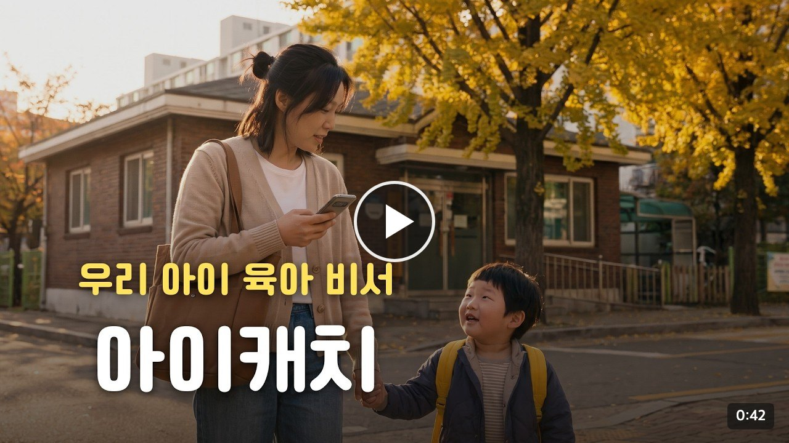</a>

<h1>아이캐치</h1>

**한 줄만 남기면, 우리 아이에게 맞는 다음 할 일로 돌아오는 육아 비서**

만 0~5세 영유아를 키우며 일하는 보호자를 위해 만들었습니다. 카카오 계정으로 로그인하면 바로 쓸 수 있습니다.

<a href="https://play.google.com/store/apps/details?id=kr.ai.icatch"></a>
<a href="https://icatch.ai.kr"></a>

<a href="https://kakaotechcampus-4.github.io/ktc4-pusan-3/"></a>
<a href="https://api.icatch.ai.kr/docs">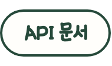</a>

<sub>카카오테크 캠퍼스 4기 2단계 · 부산대 3팀</sub>

</div>

| 아이캐치가 하는 일 | |
| --- | --- |
| **한&nbsp;줄로&nbsp;적습니다** | 칸을 고르지 않습니다. 말하듯 적으면 식사 · 건강 · 놀이 기록으로 나뉘어 저장됩니다 |
| **사진으로도&nbsp;적습니다** | 알림장과 식단표를 찍으면 일정 · 준비물 · 급식으로 정리해 보여 주고, 확인한 것만 저장합니다 |
| **기록이&nbsp;추천으로&nbsp;돌아옵니다** | 저녁 메뉴 · 주말 놀이 · 교육 활동을 아이의 기록을 근거로 제안하고, 어떤 기록을 썼는지 보여 줍니다 |
| **가족과&nbsp;같이&nbsp;봅니다** | 초대 코드로 다른 보호자를 부르면 같은 아이의 기록과 일정을 함께 봅니다 |
| **중요한&nbsp;것은&nbsp;사람이&nbsp;정합니다** | 알레르기는 코드가 막고, 일정과 건강 기록은 보호자가 승인해야 들어갑니다 |

<!-- 시연 영상(제출물)이 올라오면 위 작은 버튼 줄 맨 앞에 "시연 영상" 버튼을 더한다 (원본: my-notes 의 buttons.html) -->

## 목차

1. [육아 기록은 귀찮고, 적어도 돌아오는 게 없었습니다](#육아-기록은-귀찮고-적어도-돌아오는-게-없었습니다)
2. [한 줄이 추천이 되기까지](#한-줄이-추천이-되기까지)
3. [기록이 쌓일수록 추천이 달라집니다](#기록이-쌓일수록-추천이-달라집니다)
4. [그래도 AI 에게 맡기지 않은 것이 있습니다](#그래도-ai-에게-맡기지-않은-것이-있습니다)
5. [어떻게 만들었나](#어떻게-만들었나) — [한 줄이 지나가는 길](#한-줄이-지나가는-길) · [돌아가는 곳](#돌아가는-곳) · [운영하면서 지켜보는 것](#운영하면서-지켜보는-것)
6. [만들면서 부딪힌 것](#만들면서-부딪힌-것)
7. [정말 그렇게 움직이는지 쟀습니다](#정말-그렇게-움직이는지-쟀습니다)
8. [직접 돌려 보기](#직접-돌려-보기)
9. [만든 사람들](#만든-사람들)
10. [더 궁금하면](#더-궁금하면)

## 육아 기록은 귀찮고, 적어도 돌아오는 게 없었습니다

아이 일은 매일 적을 게 생기는데, 기록 앱은 오래 쓰기 어렵습니다. 2026년 8월에 보호자 10명에게 물었더니, 아이가 있는 9명 가운데 지금 기록을 남기는 사람은 없었고 7명은 하다가 그만둔 상태였습니다. 그만둔 7명 가운데 5명이 "매일 입력하는 게 번거로웠다" 나 "기록해도 다시 볼 일이 없었다" 를 골랐습니다. 아이캐치는 이 두 가지를 풉니다.

| | 불편 | 아이캐치는 |
| :---: | --- | --- |
| **적&#8288;을&nbsp;때** | 식사 · 수면 · 건강 칸을 골라 항목을 하나씩 채워야 한다 | 가족에게 말하듯 **한 줄**만 남긴다. 나눠 담는 일은 AI 가 한다 |
| **적&#8288;은&nbsp;뒤** | 기록이 쌓이기만 하고 쓸 데가 없다 | 쌓인 기록이 **우리 아이에게 맞는 추천**이 되어 돌아온다 |

보호자는 이미 매일 아이 이야기를 하고 있습니다. 배우자에게, 가족 채팅방에.
아이캐치는 새 습관을 요구하지 않고 그 한 줄을 받는 곳만 바꿉니다.
그리고 받은 한 줄을 근거로 저녁 메뉴 · 주말 놀이 · 일정 같은 다음 할 일을 준비해 둡니다.
같은 설문에서 지난 한 달 사이 8명이 주말에 아이와 무엇을 할지 검색했고, 5명이 기관 준비물이나 공지를 놓쳤다고 답했습니다.

<details>
<summary>설문 집계 보기 (보호자 10명 · 어린이집 교사 2명)</summary>

<br>

**보호자 설문** · 2026년 8월 · 온라인 · 10명. 임신 중 1명, 나머지 9명은 막내 기준 만 0\~2세 2명 · 3\~5세 4명 · 6\~7세 1명 · 11세 이상 2명입니다. 표본이 작아서 방향을 잡는 데만 썼습니다.

| 물은 것 | 답 (명) |
| --- | --- |
| 아이 기록을 남기고 있나 (아이가 있는 9명) | 지금 남긴다 0 · 하다가 그만뒀다 7 · 해 본 적 없다 2 |
| 그만둔 이유 (7명 · 여럿 선택) | 아이가 자라며 필요가 줄었다 4 · 매일 입력하는 게 번거로웠다 3 · 기록해도 다시 볼 일이 없었다 3 · 시간이 없었다 1 |
| 지난 한 달에 겪은 일 (9명 · 여럿 선택) | 주말에 아이와 무엇을 할지 검색했다 8 · 기관 준비물이나 공지를 놓치거나 늦게 알았다 5 · 무엇을 먹일지 정하는 데 시간을 썼다 3 · 장난감 · 책을 찾은 뒤 우리 아이에게 맞을지 다시 고민했다 3 · 다른 보호자에게 아이의 최근 상황을 다시 설명했다 2 |
| 아이 일을 AI 에 물어본 적이 있나 (10명) | 없다 7 · 있다 3. 있다고 한 3명 중 2명이 "물어볼 때마다 아이의 나이 · 성향 · 상황을 다시 설명해야 했다" 를 골랐다 |
| 가장 먼저 써 보고 싶은 기능 (10명) | 오늘 무엇을 먹일지 제안 5 · 알림장에서 준비물 · 일정 정리 2 · 관심사에 맞는 놀이 · 주말 활동 제안 2 · 아이에 대해 쌓인 것을 한눈에 보기 1 |
| 걱정되는 점 (10명 · 여럿 선택) | 아이 정보를 AI 에 입력하는 것 자체가 꺼려진다 8 · 결국 내가 입력해야 하니 또 하나의 할 일이 될 것 같다 3 · AI 조언을 믿을 수 있을지 모르겠다 3 · AI 가 아이를 잘못 판단할 것 같다(한 번 본 걸 좋아한다고 단정하는 등) 3 |
| 써 보고 싶은 정도 (5점 만점) | 평균 4.1 · 4점 이상 9 |

**어린이집 교사 설문** · 2026년 9월 · 2명. 급식표는 두 곳 모두 한 달에 한 번 나오고 점심 · 오전 간식 · 오후 간식이 들어 있습니다. 알레르기 표기는 한 곳이 괄호 숫자, 다른 한 곳이 원문자였습니다. 공지는 키즈노트 · 종이 · 카카오톡으로 나뉘어 나갑니다.

</details>

**AI 챗봇에게 물어보면 되지 않을까요.** 저녁 메뉴는 챗봇도 잘 답합니다. 다만 그 답은 우리 아이의 것이 아닙니다.

| | 그때그때 묻는 챗봇 | 아이캐치 |
| :---: | --- | --- |
| **아&#8288;이&#8288;를&nbsp;아&#8288;는&#8288;가** | 물을 때마다 아이 이야기를 다시 설명한다 | 적어 둔 한 줄이 아이의 기억으로 쌓여 있다 |
| **왜&nbsp;이&nbsp;답&#8288;인&#8288;가** | 근거를 알 수 없다 | 추천마다 사용한 기록이 붙는다 |
| **틀&#8288;릴&nbsp;때** | 그럴듯하게 틀린다 | 알레르기와 날짜는 코드가 막고, 근거가 없으면 일반 추천이라고 밝힌다 |

설문에서 가장 많이 나온 걱정은 "아이 정보를 AI 에 입력하는 것 자체가 꺼려진다"(10명 중 8명)였고, 3명은 "AI 가 한 번 본 걸 좋아한다고 단정할 것 같다" 를 골랐습니다. 앞의 걱정에는 [외부 LLM 으로 나가는 아이 정보](https://kakaotechcampus-4.github.io/ktc4-pusan-3/safety/llm-inputs-v1/)로, 뒤의 걱정에는 [기록이 쌓일수록 추천이 달라집니다](#기록이-쌓일수록-추천이-달라집니다)와 [그래도 AI 에게 맡기지 않은 것이 있습니다](#그래도-ai-에게-맡기지-않은-것이-있습니다)로 답합니다.

## 한 줄이 추천이 되기까지

> 저녁에 계란말이 또 먹었어. 어젯밤엔 자다가 기침 몇 번 했어

보호자가 적는 것은 이 한 줄이 전부입니다. 이 한 줄이 추천이 되기까지를 화면 네 장으로 따라갑니다.

<table>
<tr>
<th width="25%">① 말하듯 적습니다</th>
<th width="25%">② 나눠서 저장합니다</th>
<th width="25%">③ 추천으로 돌아옵니다</th>
<th width="25%">④ 중요한 것만 묻습니다</th>
</tr>
<tr>
<td align="center">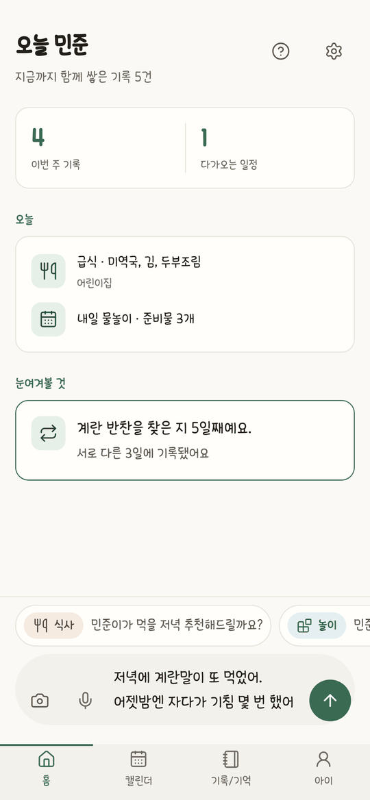</td>
<td align="center">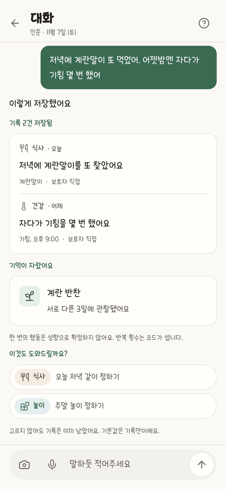</td>
<td align="center">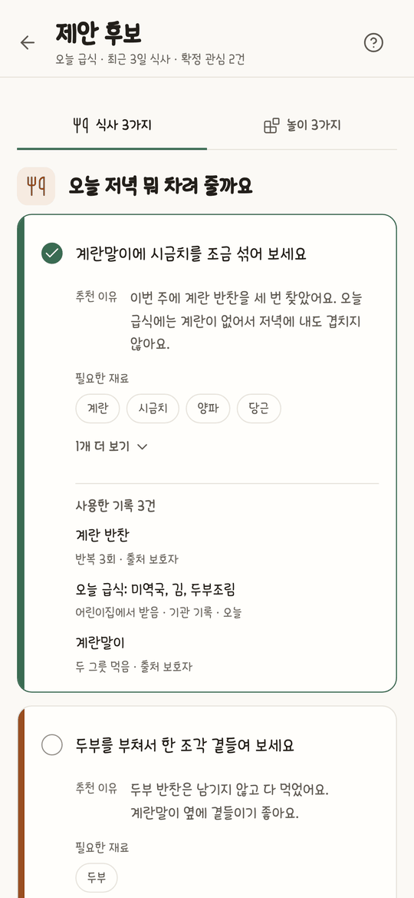</td>
<td align="center">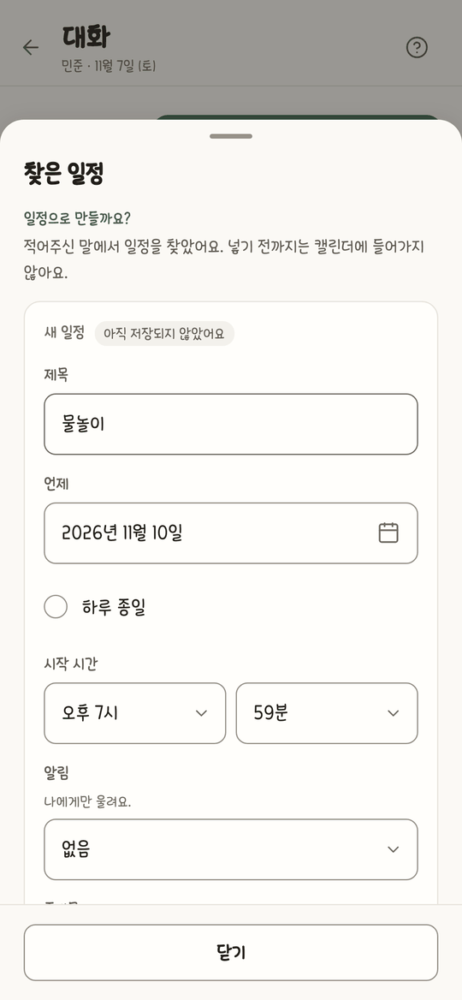</td>
</tr>
<tr>
<td valign="top">칸을 고르지 않습니다. 말로 해도 되고, 알림장은 사진으로 찍어도 됩니다</td>
<td valign="top">식사 1건과 건강 1건이 됐습니다. 계란 반찬을 찾은 날은 서로 다른 3일째입니다</td>
<td valign="top">"오늘 저녁 뭐 해 주지?" 라고 물으면 쌓인 기록에서 답을 찾습니다</td>
<td valign="top">일정은 넣기 전까지 캘린더에 들어가지 않습니다</td>
</tr>
</table>

- **한 번 적었다고 성향으로 정하지 않습니다.** ② 의 "기억이 자랐어요" 는 계란 반찬을 찾은 날이 서로 다른 3일이 됐다는 뜻입니다. 같은 날 세 번 적어도 하루로 셉니다.
- **근거가 보이니 틀린 추천을 알아볼 수 있습니다.** ③ 의 추천마다 왜 이것인지와 어떤 기록을 썼는지가 붙습니다. 적어 둔 것이 여기서 쓰입니다.
- **묻는 것은 되돌리기 어려운 것뿐입니다.** 기록은 묻지 않고 바로 저장합니다. 확인이 많아지면 한 줄로 줄인 보람이 없기 때문입니다.

**실제 앱에서는 이렇게 움직입니다.** 시연 영상에서 하원길 장면만 잘랐습니다.

<table>
<tr>
<td width="300" align="center">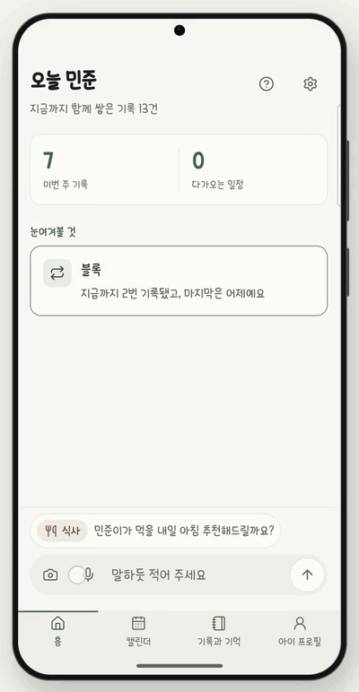</td>
<td valign="top">

보호자가 말로 남긴 것은 이것뿐입니다.

> 민준이가 점심을 많이 안 먹었대. 저녁엔 오일째 계란말이만 해달래. 오늘 저녁은 다른 계란 요리 추천해 줘

1. 한 줄이 **기록 두 건**으로 나뉘어 저장됩니다
2. 닷새째 계란말이였다는 기록을 근거로 **다른 계란 요리**를 고릅니다
3. **처음 보는 식품**은 먹어 본 적이 있는지 먼저 묻습니다
4. 일정은 누르기 전까지 캘린더에 들어가지 않습니다

</td>
</tr>
</table>

## 기록이 쌓일수록 추천이 달라집니다

적은 만큼 돌아와야 계속 적게 됩니다. 그래서 추천은 쌓인 기록에 따라 다르게 나갑니다.

<table>
<tr>
<th width="50%">기록이 적을 때</th>
<th width="50%">기록이 쌓였을 때</th>
</tr>
<tr>
<td align="center">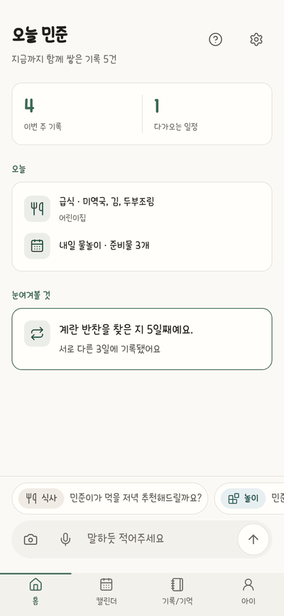</td>
<td align="center">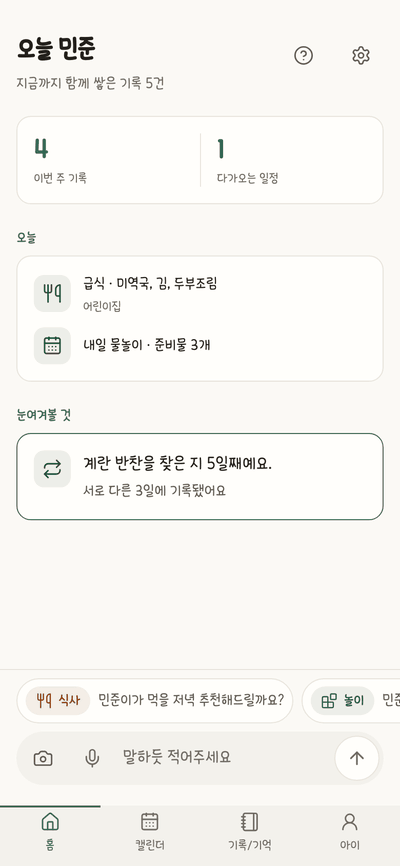</td>
</tr>
<tr>
<td valign="top">놀이를 물었는데 놀이 기록은 1건뿐입니다. 또래 기준의 일반 추천을 내고 카드에 "일반 추천" 이라고 적습니다. 맞춤인 척하지 않고, 되묻는 질문은 하나만 합니다</td>
<td valign="top">같은 아이에게 저녁을 물었습니다. 계란 반찬이 서로 다른 3일에 적혀 있어서, 추천마다 이유와 사용한 기록이 붙습니다</td>
</tr>
</table>

그 사이에서는 이렇게 달라집니다.

| 기록이 적힌 정도 | 추천은 |
| --- | --- |
| **한두&nbsp;번** | 근거로는 쓰지만 아이의 성향으로 정하지 않습니다 |
| **2주&nbsp;안에 서로&nbsp;다른&nbsp;3일** | 확정된 기억이 되어 추천의 근거로 먼저 쓰입니다 |
| **3주&nbsp;동안 다시&nbsp;안&nbsp;적힘** | 3주 동안 다시 적히지 않은 관심은 보관되어 근거에서 빠집니다. 6개월이 지난 기록은 어떤 경우에도 혼자 근거가 되지 못합니다 |
| **보호자가&nbsp;고침** | "이번만 그랬어요" · "잘못된 기록" 에 따라 기억이 바뀝니다 |

근거가 없을 때 추천을 멈추지 않고 일반 추천을 내기로 한 이유는 [설계 결정 §8](https://kakaotechcampus-4.github.io/ktc4-pusan-3/overview/decisions-v1/#8-근거가-없을-때--추천하지-않는다-에서-일반-추천임을-밝히고-낸다-로)에 있습니다.

## 그래도 AI 에게 맡기지 않은 것이 있습니다

저녁 메뉴는 틀려도 한 끼입니다. 알레르기와 일정은 그렇지 않습니다.
그래서 기능을 붙일 때마다 "이 일을 누가 하는가" 부터 정했습니다. 질문은 두 개입니다.

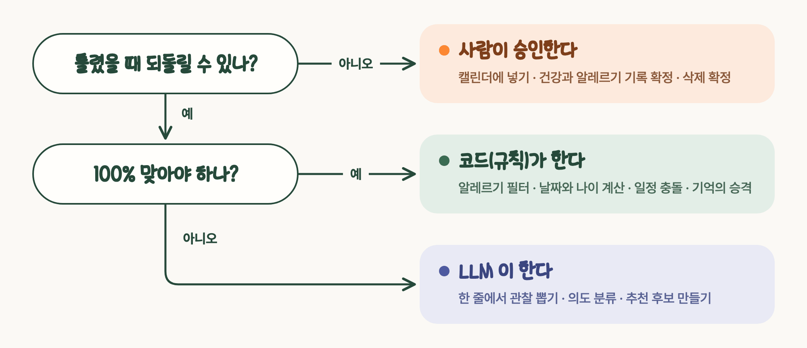

| 누가 | 무엇을 | 위의 한 줄에서는 |
| :---: | --- | --- |
| **사람** | 캘린더에 넣기 · 건강과 알레르기 기록 확정 · 대화로 지울 때의 삭제 확정 | Agent 는 일정 초안까지만 만든다. 승인 전에는 저장하지 않는다 |
| **코드** | 알레르기 필터, 날짜 · 나이 계산, 일정 충돌, 기억의 승격, 추천 근거의 순서 | 계란말이 추천은 알레르기 필터를 지난 뒤에만 나온다. 알레르기를 읽지 못하면 "없음" 으로 넘기지 않고 추천 없이 닫는다 |
| **LLM** | 한 줄에서 관찰 뽑기, 의도 분류, 식사 · 놀이 · 교육 후보 만들기 | 한 줄을 식사와 건강으로 나눈다. 기침은 적어 둘 뿐 무슨 병인지 말하지 않는다 |

> [!IMPORTANT]
> 진단하지 않습니다. 한 번의 관찰로 아이의 성향을 확정하지 않습니다. 근거가 없으면 일반 추천이라고 밝힙니다.

규칙 전체는 CLAUDE.md 의 [§2 절대 규칙](CLAUDE.md#2-절대-규칙)과 [§3 자율성 경계](CLAUDE.md#3-자율성-경계--누가-무엇을-하는가)에, 기록 저장에 왜 확인을 받지 않는지는 [설계 결정 §7](https://kakaotechcampus-4.github.io/ktc4-pusan-3/overview/decisions-v1/#7-저장하기-전-승인--뺐다)에 있습니다.

## 어떻게 만들었나

### 한 줄이 지나가는 길

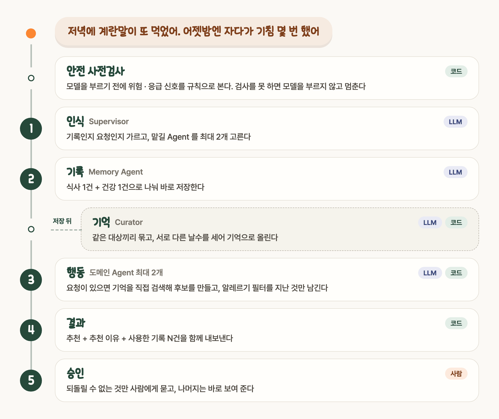

| 이렇게 만들었다 | 왜 |
| --- | --- |
| **모델보다 규칙이 먼저** | 위험 · 응급 신호 검사는 Supervisor 앞에 있다. 검사를 못 하면 모델을 부르지 않고 멈춘다 |
| **역할마다 모델을 바꿀 수 있게** | Supervisor · Memory · 도메인 Agent 가 각자 키 · 모델 · 추론 강도 설정을 갖는다. 지금은 다섯 역할이 같은 모델을 쓰고, 사진 읽기만 다른 모델을 쓴다 |
| **저장이 검색보다 먼저** | 방금 저장한 기록이 같은 요청의 추천 근거로 잡혀야 한다. 그래서 백엔드와 AI 를 한 서비스로 묶었다 |
| **20초를 넘기면 부분 결과** | Agent 하나가 늦거나 실패해도 끝난 쪽은 먼저 보여 준다 |
| **성향은 규칙이 올린다** | 기억은 `candidate` 로 시작하고 반복 집계를 거쳐야 `confirmed` 가 된다. LLM 은 이 상태를 쓰지 못한다 |

Agent 별 설계는 [Supervisor](https://kakaotechcampus-4.github.io/ktc4-pusan-3/agents/supervisor-agent-v1/) · [Memory](https://kakaotechcampus-4.github.io/ktc4-pusan-3/agents/memory-agent-v1/) · [Curator](https://kakaotechcampus-4.github.io/ktc4-pusan-3/memory/curator-linking-v1/) · [Activity](https://kakaotechcampus-4.github.io/ktc4-pusan-3/agents/activity/activity-agent-v1/) 문서에, Agent 가 함께 지키는 약속은 [공통 규약](https://kakaotechcampus-4.github.io/ktc4-pusan-3/agents/shared/Agent_공통규약/)에 있습니다.

### 돌아가는 곳

<div align="center">


</div>

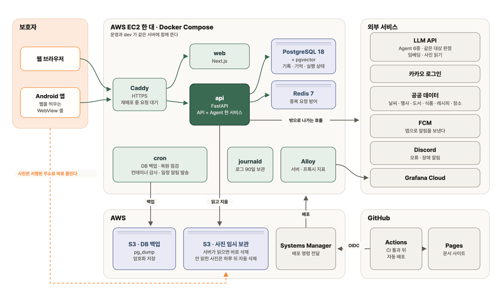

| 고른 것 | 왜 |
| --- | --- |
| 모바일은 **웹뷰 껍데기** | 화면이 두 벌이 되면 절대 규칙도 두 곳에서 지켜야 한다 |
| 벡터 DB 를 따로 두지 않고 **PostgreSQL 한 곳** | 여섯 명이 10주에 운영할 인프라는 적을수록 좋다 |
| 사진은 화면이 **S3 에 바로** 올린다 | 업로드가 API 서버를 거치지 않는다. 서버는 읽을 때만 내려받고 바로 지운다. 끝내 읽히지 않은 사진은 S3 규칙이 하루 뒤에 지운다 |
| 배포는 **OIDC + Systems Manager** | 저장소에 서버 열쇠를 두지 않는다 |

내부 주소 · 버킷 정책 · 권한까지 그린 자세한 구성도는 [배포 문서 · 한눈에](https://kakaotechcampus-4.github.io/ktc4-pusan-3/ops/deploy-v1/#한눈에)에, 되돌리는 법은 [롤백](https://kakaotechcampus-4.github.io/ktc4-pusan-3/ops/deploy-v1/#롤백--무엇이-되돌아가고-무엇이-안-되돌아가나)에, 상태를 DB 로 옮긴 이유는 [설계 결정 §2](https://kakaotechcampus-4.github.io/ktc4-pusan-3/overview/decisions-v1/#2-워커를-늘리기-위한-상태-저장소--redis-가-더-잘-맞는-도구인데-postgresql-을-골랐다)에 있습니다.

### 운영하면서 지켜보는 것

서버는 한 대라서, 죽었을 때 사람이 먼저 알아채는 일이 없게 했습니다. 알림은 전부 Discord 한 채널로 모입니다.

| 무엇이 잘못되면 | 누가 알아채나 |
| --- | --- |
| API 에서 오류가 난다 | 앱이 ERROR 로그를 알림 카드로 보낸다. 카드에는 오류의 종류와 위치만 싣는다 |
| 보호자 화면에서 오류가 난다 | 화면이 서버로 보고한다. 종류 · 경로 · 기기 요약뿐이다 |
| 컨테이너가 죽거나 DB · Redis 에 닿지 못한다 | 서버 cron 이 1분마다 보고, 상태가 바뀔 때만 알린다 |
| 서버가 통째로 죽는다 | UptimeRobot 이 5분마다 밖에서 찔러 본다 |
| 서버는 살아 있는데 백업이 멈춘다 | GitHub Actions 가 매일 밖에서 가장 새 백업의 시각을 본다 |
| CPU · 메모리 · 디스크 · 응답 코드가 이상하다 | Alloy 가 Grafana Cloud 로 보낸 지표를 대시보드로 본다 |

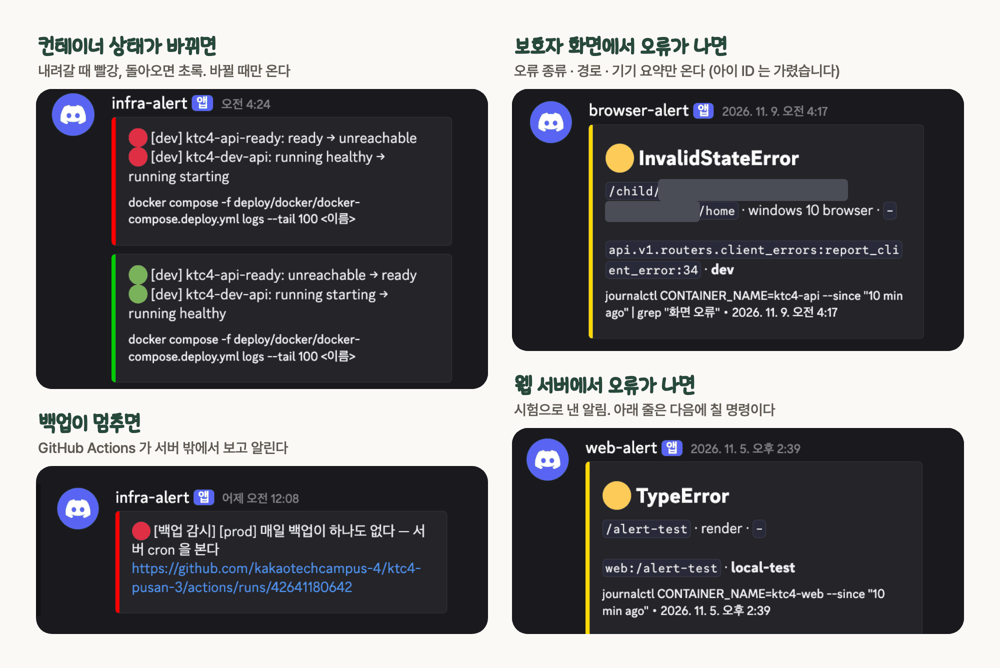

<div align="center">
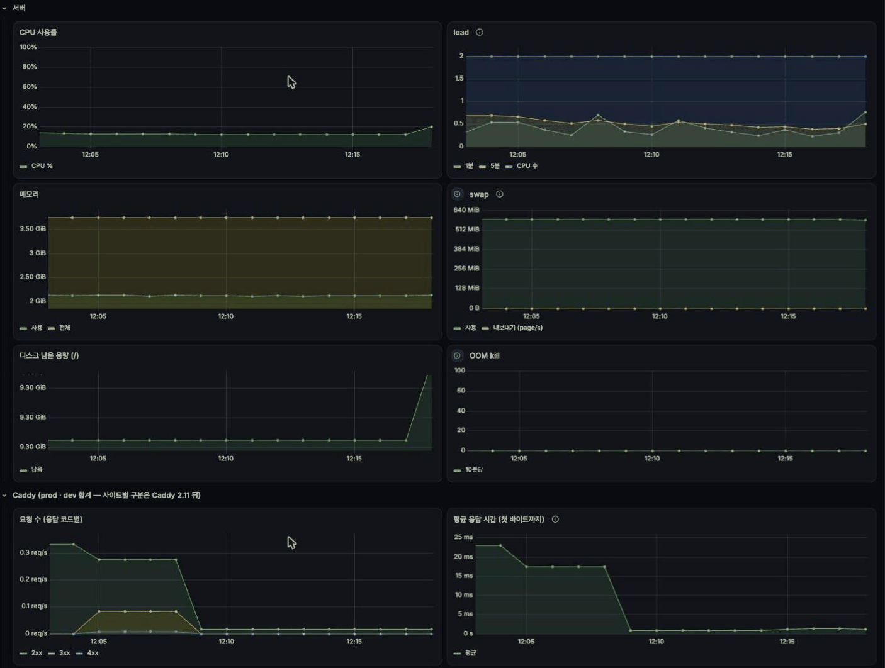
<br><sub>Grafana Cloud 대시보드. 서버 자원과 Caddy 가 받은 요청을 60초마다 모읍니다.</sub>
</div>

아이의 기록 가운데 무엇이 외부 모델로 나가는지는 [외부 LLM 으로 나가는 아이 정보](https://kakaotechcampus-4.github.io/ktc4-pusan-3/safety/llm-inputs-v1/)에, 얼마나 보관하고 언제 지우는지는 [개인정보 보관 · 삭제 기준](https://kakaotechcampus-4.github.io/ktc4-pusan-3/safety/retention-v1/)에 적었습니다.

오류 추적 SaaS 는 쓰지 않았습니다. 로그 줄에는 보호자가 적은 원문이 들어갈 수 있어서, 그 내용이 밖으로 나가는 도구는 고르지 않았습니다.
그래서 알림에는 값이 아니라 종류와 위치만 싣고, 원문이 든 로그는 서버 안(journald)에만 둡니다. LLM 호출도 같습니다. 호출마다 어느 run 이 어느 모델을 얼마나 썼는지는 DB 에 남기지만, 프롬프트와 응답은 남기지 않습니다.

알림을 이렇게 짠 이유는 [로그 · 알림 문서 §1 결정](https://kakaotechcampus-4.github.io/ktc4-pusan-3/ops/logging-alerts-v1/#1-결정)에, 알림이 못 잡는 것은 [§5](https://kakaotechcampus-4.github.io/ktc4-pusan-3/ops/logging-alerts-v1/#5-알림이-못-잡는-것)에, 서버 지표는 [§7 Grafana Cloud](https://kakaotechcampus-4.github.io/ktc4-pusan-3/ops/logging-alerts-v1/#7-서버-메트릭--grafana-cloud-946)에 있습니다.

## 만들면서 부딪힌 것

| 부딪힌 것 | 원인 | 한 일 | 결과 |
| --- | --- | --- | --- |
| 다시 누른 한 줄이 [**두 번 저장**](https://kakaotechcampus-4.github.io/ktc4-pusan-3/overview/decisions-v1/#1-중복-요청-방어--프로세스-메모리에서-redis-로-그리고-redis-가-죽으면-막는다)된다 | 저장은 됐는데 응답만 사라졌다 | `Idempotency-Key` 를 Redis 에 기억. Redis 가 죽으면 메모리로 넘기지 않고 503 | 같은 키 10번 → 저장 1건 |
| 같은 키가 [**동시에**](https://kakaotechcampus-4.github.io/ktc4-pusan-3/ops/workers-2-check-v1/#①-처음-보는-키가-동시에-오면-중복-저장된다) 오면 못 막는다 | 키 읽기와 쓰기가 따로였다 (워커 2개 실험에서 발견) | `SET NX` 한 번으로 합쳤다 | 동시 8개 × 300번, 중복 0 |
| [**재배포**](https://kakaotechcampus-4.github.io/ktc4-pusan-3/ops/deploy-v1/#drain--옛-api-가-하던-일을-끝내고-내려간다-882) 중 요청이 502, 돌던 요청은 사라진다 | 컨테이너가 한 번에 하나만 뜬다 | 돌던 요청은 끝내고 내려가고, 새 요청은 프록시가 붙잡는다 | 돌던 요청 정리 110초 < 강제 종료 120초 < 프록시가 기다리는 150초 |
| 계란과 달걀을 [**다른 것**](https://kakaotechcampus-4.github.io/ktc4-pusan-3/overview/decisions-v1/#3-같은-대상인지-판단--임베딩-유사도에서-llm-판정으로)으로 본다 | 임베딩 유사도가 뜻이 아니라 글자를 따라갔다 (0.20) | "같은 대상인가" 만 묻는 LLM 판정 | 유사도는 후보 추리기에만 |
| 긴 입력에서 [**출력이 잘린다**](https://kakaotechcampus-4.github.io/ktc4-pusan-3/overview/decisions-v1/#5-한-줄-입력-상한--2000자에서-500자로) | 1,000자부터 Supervisor 출력이 상한에 걸렸다 | 길이별로 재서 500자로 | 긴 글은 사진 읽기로 |

굵은 글자를 누르면 그 일의 계기 · 비교 · 대가로 갑니다. 전체는 [설계 결정 8개와 그 밖의 변경](https://kakaotechcampus-4.github.io/ktc4-pusan-3/overview/decisions-v1/)에 있습니다.

## 정말 그렇게 움직이는지 쟀습니다

"근거를 단다" · "알레르기는 코드가 막는다" 는 말은 재 봐야 압니다. 실제 모델로 돌린 결과입니다. 시나리오는 11월 11일에 다시 잰 값이고, 나머지는 11월 10일 기준선입니다.

<table>
<tr>
<td align="center" valign="top" width="25%"><h3>9 / 10</h3><b>기획 때 정한 시나리오</b><br><sub>실제 모델 · 3회 모두 통과해야 통과</sub></td>
<td align="center" valign="top" width="25%"><h3>0건</h3><b>절대 규칙 위반</b><br><sub>147 run 을 코드로 판정</sub></td>
<td align="center" valign="top" width="25%"><h3>39 / 40</h3><b>장애 점검</b><br><sub>부품 10 × 장애 4 · make test 마다</sub></td>
<td align="center" valign="top" width="25%"><h3>68 / 69</h3><b>급식표 끼니 읽기</b><br><sub>급식표 1장(27일 · 69끼니)을 5번 · 틀린 메뉴가 한 번도 붙지 않은 끼니</sub></td>
</tr>
</table>

응답 시간은 11월 10일 기준선 실행에서 쟀습니다. 기록만 하는 한 줄은 중앙값 4.4초, 기록과 요청이 섞인 한 줄은 느린 쪽 5% 가 15.2초였고, 20초를 넘겨 부분 결과로 바뀐 실행은 143번 가운데 없었습니다. 다섯 역할 모두 같은 모델(`gpt-5.6-luna`)로 쟀고, 입력 종류별 호출 수 · 토큰 수는 [비용 · 지연](eval/results/2026-11-10.md#비용--지연) 표에 있습니다. 급식표는 `gemini-4-argon` 으로 읽습니다.

<details>
<summary>시나리오 10개 보기</summary>

<br>

기획 때 정한 10개입니다. 6개는 제품이 틀리기 쉬운 상황을 일부러 만든 것입니다.

| # | 무엇을 보나 | 11월 11일 |
| :---: | --- | :---: |
| 1 | 기록과 요청이 섞인 한 줄을 관찰 여러 건으로 나눠 저장하고 일정을 뽑는다 | 실패 0/3 |
| 2 | 등록된 알레르기를 반영해 간식을 추천한다 | 통과 |
| 3 | 공지에서 일정 초안과 준비물을 뽑고, 승인 전에는 저장하지 않는다 | 통과 |
| 4 | 하루 본 것을 아이의 성향으로 말하지 않는다 | 통과 |
| 5 | 교육 고민에 정해진 범위 안에서 답한다 | 통과 |
| 6 | 되물은 뒤 받은 답을 앞 문장에 이어 저장한다 | 통과 |
| 7 | 짜증 고민에 원인 · 병명을 단정하지 않는다 | 통과 |
| 8 | 기록이 0건이면 일반 추천을 내고 맞춤인 척하지 않는다 | 통과 |
| 9 | 아이와 무관한 질문은 기록하지도 추천하지도 않는다 | 통과 |
| 10 | 부모의 알레르기를 아이 것으로 저장하지 않는다 | 통과 |

</details>

입력과 기대 결과까지 적은 원본은 [골든셋 · 헤드라인 10개](eval/cases.md#한눈에)에, 11월 10일 기준선(8/10)과 그때 실패한 2개의 원인은 [기준선 결과 · 실패 분석](eval/results/2026-11-10.md#실패-분석)에, 고친 뒤 다시 잰 결과는 [11-11 헤드라인 다시 재기](eval/results/2026-11-11-headline.md)에, 절대 규칙을 코드로 판정하는 방법은 [eval 문서 §3-2 불변식 14개](https://kakaotechcampus-4.github.io/ktc4-pusan-3/eval/eval-v1/#3-2-불변식-14개--2-를-코드로-판정한다)에, 남은 1칸은 [장애 점검표 · 메울 구멍](eval/faults.md#메울-구멍)에, 급식표를 잰 방법은 [급식표 OCR 평가 §1 측정 이력](docs/agents/eval/MEAL_OCR_EVAL.md#1-측정-이력)에 있습니다. 그 표의 `C1 1/69` 가 틀린 메뉴가 붙은 끼니 1개이고, 68/69 는 그것을 뒤집어 적은 값입니다.

> [!NOTE]
> **아직 못 한 것**
> - 서버는 한 대, 워커는 1개입니다. 상태를 DB 로 옮겨 늘릴 준비까지만 했습니다 ([워커 2개로 돌려 본 기록](https://kakaotechcampus-4.github.io/ktc4-pusan-3/ops/workers-2-check-v1/#결과)).
> - 10개 시나리오 중 1개가 아직 통과하지 못합니다. 기준선에서 실패한 2개를 고치고([#841](https://github.com/kakaotechcampus-4/ktc4-pusan-3/pull/841) · [#950](https://github.com/kakaotechcampus-4/ktc4-pusan-3/pull/950)) 다시 재니, 되묻기 답 이어받기는 3회 모두 통과했고 기록과 요청이 섞인 한 줄은 3회 모두 실패했습니다. 놀이와 일정은 저장되는데, 먹은 양만 말한 끼니("밥 반 공기")를 식사 기록으로 받지 못합니다. 다시 잰 것은 이 10개뿐이고 전체는 다시 재지 않았습니다.
> - 급식표는 한 가지 양식 1장으로만 쟀습니다. 다른 기관 · 다른 양식은 아직 재지 못했습니다.
> - 실제 사용자는 아직 거의 없습니다(팀과 테스터). 위 숫자는 모두 미리 써 둔 입력으로 잰 값입니다.
> - 추천 카드의 채택 · 평가는 아직 아이의 성향에 반영되지 않습니다.
> - 복약 기록은 스토어 정책 때문에 닫아 두었고, Health Agent 는 추천 없이 기록과 안내만 합니다.

## 직접 돌려 보기

필요한 것: Docker · Python 3.12 + [uv](https://docs.astral.sh/uv/) · Node 24 + pnpm

```bash
git clone https://github.com/kakaotechcampus-4/ktc4-pusan-3.git && cd ktc4-pusan-3

make db-up                                   # PostgreSQL(pgvector) + Redis
cp apps/api/.env.example apps/api/.env       # 모델 키 등을 채운다
make install && make db-migrate && make dev  # API → http://localhost:8000/docs

cp apps/web/.env.example apps/web/.env.local # 다른 터미널에서
make web-install && make web-dev             # 웹 → http://localhost:3000
```

모델 키는 `MEMORY_API_KEY` · `MEMORY_BASE_URL` · `MEMORY_MODEL` 세 개만 채우면 Agent 역할(Supervisor · Food · Activity · Growth · Health)이 그 값을 따라갑니다. OpenAI 호환 엔드포인트면 됩니다. 임베딩과 사진 읽기는 키가 따로이고, 비우면 그 기능만 꺼집니다.

웹에서 API 를 부르려면 `apps/api/.env` 의 `CORS_ALLOW_ORIGINS` 에 `http://localhost:3000` 을 넣습니다.

로그인에는 카카오 키가 필요합니다. 키가 없거나 백엔드 없이 화면만 보려면 `apps/web/.env.local` 에서 `NEXT_PUBLIC_API_MOCKING=enabled` 로 바꿉니다.

| 무엇을 검사하나 | 명령 | CI · 최근 30일 성공률 |
| --- | --- | :---: |
| API 단위 · 통합 · 장애 점검 | `make test` | [API CI](https://github.com/kakaotechcampus-4/ktc4-pusan-3/actions/workflows/ci-api.yml) · 96% |
| 웹 단위 · 화면 규칙 e2e | `make web-test` · `make web-e2e` | [Web CI](https://github.com/kakaotechcampus-4/ktc4-pusan-3/actions/workflows/ci-web.yml) · 97% |
| 웹 ↔ 서버 계약 | `make web-contract` | [Contract CI](https://github.com/kakaotechcampus-4/ktc4-pusan-3/actions/workflows/ci-contract.yml) · 99% |
| 실서버 e2e | `make web-e2e-live` | [Live E2E CI](https://github.com/kakaotechcampus-4/ktc4-pusan-3/actions/workflows/ci-e2e-live.yml) · 100% |
| AI 품질 전체 (실제 모델) | `make eval` | 손으로 돌린다 |
| AI 품질, 바뀐 Agent 만 | PR 에서 자동 | [Agent live eval](https://github.com/kakaotechcampus-4/ktc4-pusan-3/actions/workflows/ci-agent-live.yml) · 프롬프트나 tool spec 이 바뀐 Agent 를 실제 모델로 3회 |

성공률은 2026-11-11 기준이고, develop 브랜치에서 돈 실행만 세었으며 새 push 로 취소된 실행은 뺐습니다.

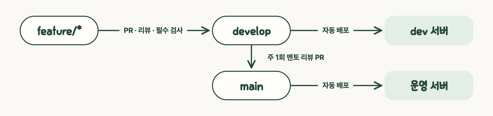

배포가 도는 순서는 [배포 문서 · 한눈에](https://kakaotechcampus-4.github.io/ktc4-pusan-3/ops/deploy-v1/#한눈에)에, 재배포 중에 돌던 요청을 지키는 방법은 [drain](https://kakaotechcampus-4.github.io/ktc4-pusan-3/ops/deploy-v1/#drain--옛-api-가-하던-일을-끝내고-내려간다-882)에 있습니다.

## 만든 사람들

<table>
<tr>
<td align="center" width="16%"><a href="https://github.com/jjaa0803"><br><b>박재형</b></a><br><sub>PM · 정책<br>API 일부</sub></td>
<td align="center" width="16%"><a href="https://github.com/tomchaccom"><br><b>김명성</b></a><br><sub>백엔드 · DB<br>배포</sub></td>
<td align="center" width="16%"><a href="https://github.com/nnhhlee"><br><b>이시하</b></a><br><sub>AI Agent<br>Supervisor · Memory 외</sub></td>
<td align="center" width="16%"><a href="https://github.com/03leedo"><br><b>이도헌</b></a><br><sub>AI Agent (Activity)<br>평가</sub></td>
<td align="center" width="16%"><a href="https://github.com/Hyeonsik-0"><br><b>오현식</b></a><br><sub>API<br>평가</sub></td>
<td align="center" width="16%"><a href="https://github.com/koty08"><br><b>고태영</b></a><br><sub>웹<br>모바일</sub></td>
</tr>
</table>

커밋 3,780개 · 머지된 PR 553개 · 멘토 리뷰 8회 (2026-11-11 기준). 일하는 규칙은 [CONTRIBUTING.md](CONTRIBUTING.md)에, 여섯 명과 AI 코딩 도구가 함께 읽는 절대 규칙 · 용어는 [CLAUDE.md](CLAUDE.md)에 있습니다.

## 더 궁금하면

| 궁금한 것 | 여기 |
| --- | --- |
| Agent 를 어떻게 설계했나 | [Supervisor](https://kakaotechcampus-4.github.io/ktc4-pusan-3/agents/supervisor-agent-v1/) · [Memory](https://kakaotechcampus-4.github.io/ktc4-pusan-3/agents/memory-agent-v1/) · [Curator](https://kakaotechcampus-4.github.io/ktc4-pusan-3/memory/curator-linking-v1/) · [공통 규약](https://kakaotechcampus-4.github.io/ktc4-pusan-3/agents/shared/Agent_공통규약/) |
| 왜 그렇게 바꿨나 | [설계 결정 8개](https://kakaotechcampus-4.github.io/ktc4-pusan-3/overview/decisions-v1/) |
| 처음 기획은 어땠나 | [서비스 기획](docs/overview/service-plan.md) · [테크스펙 (기획 당시)](docs/overview/tech-spec.md) |
| API 는 어떻게 생겼나 | [Swagger](https://api.icatch.ai.kr/docs) — 서버 코드에서 만들어지는 계약 정본 |
| AI 품질을 어떻게 쟀나 | [eval 문서 · 한 화면 요약](https://kakaotechcampus-4.github.io/ktc4-pusan-3/eval/eval-v1/#0-한-화면-요약) · [결과](eval/results/2026-11-10.md#헤드라인-810--판정-못-함-0--불안정-1--미실행-0) |
| 서버를 어떻게 굴리나 | [배포](https://kakaotechcampus-4.github.io/ktc4-pusan-3/ops/deploy-v1/#한눈에) · [로그 · 알림](https://kakaotechcampus-4.github.io/ktc4-pusan-3/ops/logging-alerts-v1/#1-결정) · [전체 문서 사이트](https://kakaotechcampus-4.github.io/ktc4-pusan-3/) |

<sub>Google Play 및 Google Play 로고는 Google LLC 의 상표입니다.</sub>
