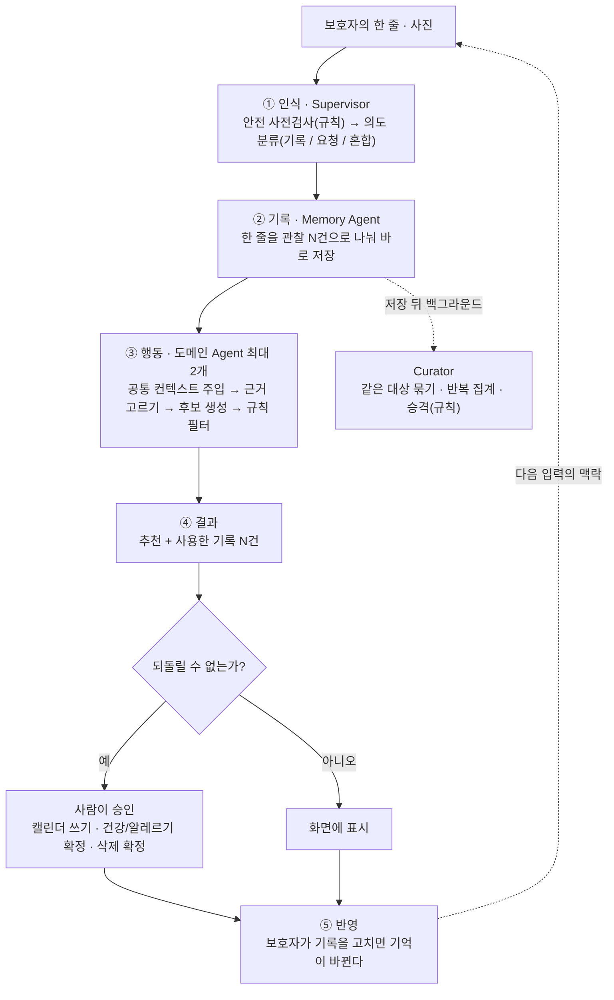

<div align="center">

# 아이캐치

**육아를 가장 많이 아는 AI가 아니라, 우리 아이를 가장 오래 알아온 AI**

[](https://youtu.be/EAYOg7bfxaI)

[서비스](https://icatch.ai.kr) · [Google Play](https://play.google.com/store/apps/details?id=kr.ai.icatch) · [소개 영상](https://youtu.be/EAYOg7bfxaI) · [개발 문서](https://kakaotechcampus-4.github.io/ktc4-pusan-3/) · [API 문서](https://api.icatch.ai.kr/docs)

[](https://github.com/kakaotechcampus-4/ktc4-pusan-3/actions/workflows/ci-api.yml)
[](https://github.com/kakaotechcampus-4/ktc4-pusan-3/actions/workflows/ci-web.yml)
[](https://github.com/kakaotechcampus-4/ktc4-pusan-3/actions/workflows/ci-contract.yml)
[](https://github.com/kakaotechcampus-4/ktc4-pusan-3/actions/workflows/ci-e2e-live.yml)

카카오테크 캠퍼스 4기 2단계 · 부산대 3팀

</div>

<!-- 시연 영상(제출물)이 올라오면 위 링크 줄의 "소개 영상" 뒤에 시연 영상 링크를 더한다 -->

## 왜 만들었나

일과 육아를 함께 하는 보호자는 알림장 · 일정 · 식사 · 아이의 반응 같은 흩어진 정보를 매번 직접 찾아 잇고, 지금 무엇이 중요한지 판단한 뒤, 다음에 할 일까지 정해야 합니다.

부족한 것은 정보가 아니라 **연결**이라고 봤습니다. 그리고 보호자는 이미 매일 아이 이야기를 하고 있습니다. 배우자에게, 메신저로. 그래서 새 습관을 요구하지 않고 그 한 줄을 받는 곳만 바꿨습니다. 보호자가 따로 정리하지 않아도 AI 가 아이의 기억을 쌓고, 그 기억을 근거로 식사 · 놀이 · 교육 · 건강에서 다음에 할 일을 준비합니다.

만들지 않는 것도 정했습니다. 진단 · 처방 · 발달 평가, 상품 추천, 대신 예약 · 결제, 아이와 직접 대화하는 AI 는 만들지 않습니다.

## 이렇게 씁니다

<!-- 시연 영상에서 딴 화면 4장을 이 표 위에 가로로 넣는다: 한 줄 남기기 → 저장 확인 → 추천(근거 N건) → 승인 -->

| | 보호자가 하는 일 | 아이캐치가 하는 일 |
| --- | --- | --- |
| 1 | 평소 말하듯 한 줄을 남긴다. 급식표 · 공지는 사진으로 올린다 | 한 줄을 관찰 여러 건으로 나눠 바로 저장하고, 무엇을 저장했는지 보여 준다 |
| 2 | "저녁 뭐 먹이지?" 처럼 묻는다 | 쌓인 기록을 근거로 추천을 만들고, **어떤 기록 몇 건을 썼는지** 함께 보여 준다 |
| 3 | 기록이 틀렸으면 고친다 ("이번만 그랬어요" · "잘못된 기록") | 고친 내용을 기억에 반영한다 |
| 4 | 캘린더에 넣기처럼 되돌릴 수 없는 것만 확인한다 | 승인 전에는 초안까지만 만든다 |

기록이 아직 없으면 맞춤인 척하지 않습니다. 또래 기준 일반 추천임을 화면에 적고, 쌓인 기록 건수를 그대로 보여 줍니다.

## 어떻게 움직이나



- **저장이 검색보다 먼저입니다.** "5일째 기침해. 저녁 뭐 먹이지?" 처럼 기록과 요청이 섞인 한 줄에서는, 방금 저장한 기록이 같은 요청의 추천 근거로 잡혀야 합니다. 그래서 쓰기를 모아서 늦게 하지 않고, 백엔드와 AI 를 한 서비스(FastAPI)로 묶었습니다. 프로세스를 나누면 이 경로마다 네트워크 왕복이 생깁니다.
- **도메인 Agent 는 `food` · `activity` · `growth` · `health` 네 개로 고정**입니다. 한 요청에 최대 두 개가 동시에 돌고, 20초를 넘기면 끝난 것만 먼저 보여 줍니다. 하나가 실패해도 성공한 쪽은 화면에 나갑니다.
- **성향은 한 번의 관찰로 정해지지 않습니다.** 기억은 `candidate` 로 시작하고, Curator 의 반복 집계(규칙)를 거쳐야 `confirmed` 가 됩니다. LLM 은 이 상태를 직접 쓰지 못합니다.

## 사람이 서는 곳은 세 군데입니다

새 기능을 붙일 때 가장 먼저 "이 일을 누가 하는가" 를 정했습니다. 기준은 두 문장입니다.

> **틀렸을 때 되돌릴 수 있나?** 못 되돌리면 사람.
> **100% 맞아야 하나?** 그러면 코드. 나머지가 LLM.

| 누가 | 무엇을 | 왜 |
| --- | --- | --- |
| **LLM** | 한 줄에서 관찰 뽑기, 의도 분류, 식사 · 놀이 · 교육 후보 만들기 | 정답이 하나가 아니고, 틀려도 고칠 수 있다 |
| **코드(규칙)** | 알레르기 필터, 날짜 · 나이 계산, 일정 충돌, 기억의 승격과 감쇠, 추천 근거의 순서 | 틀리면 안 되고, 테스트로 고정할 수 있어야 한다 |
| **사람** | ㉠ 캘린더에 넣기 ㉡ 건강 · 알레르기 기록 확정 ㉢ 대화로 지울 때의 삭제 확정 | 되돌릴 수 없다 |

게이트는 이 세 곳뿐이고, 늘리지도 줄이지도 않습니다. 승인을 늘리면 자동화의 의미가 없어지고, 줄이면 되돌릴 수 없는 일을 AI 가 혼자 하게 됩니다. Agent 는 초안까지만 만들고, 승인받지 못한 추천은 24시간 뒤 만료됩니다.

**기록 저장은 왜 묻지 않나.** 원래는 저장 전에 "이렇게 이해했어요" 를 보여 주고 확인을 받으려 했습니다. 만들면서 뺐습니다. 기록은 지울 수 있고 "이번만 그랬어요" 로 집계에서 뺄 수 있어서 되돌릴 수 있는 일입니다. 그리고 가장 자주 일어나는 일이라, 매번 확인을 받으면 "따로 정리하지 않아도 된다" 는 목표가 사라집니다. 대신 두 가지로 막았습니다.

- 한 번의 관찰이 "우리 아이는 이렇다" 가 되지 않습니다(위 승격 규칙).
- 알레르기 · 만성질환이 있다는 사실은 LLM 이 저장하지 않습니다. 보호자가 말로 "땅콩 알레르기 있어" 라고 해도 대신 저장하지 않고, 직접 입력하는 화면으로 안내합니다. 알레르기 조회에 실패하면 Food Agent 는 "알레르기 없음" 으로 넘기지 않고, 추천을 내지 않은 채 닫습니다.

관련 코드: [`delete_proposals.py`](apps/api/app/api/v1/routers/delete_proposals.py)(㉢ 삭제 확정) · [`health_safety.py`](apps/api/app/api/v1/routers/health_safety.py)(㉡) · [`suggestions.py`](apps/api/app/api/v1/routers/suggestions.py)(㉠ 일정 초안 → 일정 등록) · 전체 규칙은 [CLAUDE.md §2 · §3](CLAUDE.md)

## 만들면서 바꾼 결정

계획대로 된 것보다 바꾼 것이 더 많았습니다. 각 결정의 계기 · 비교 · 대가는 [설계 결정 문서](docs/overview/decisions-v1.md)에 풀어 썼습니다.

| 무엇 | 원래 계획 | 바꾼 것 | 이유 |
| --- | --- | --- | --- |
| 중복 요청 방어 | 프로세스 메모리에 기억 | Redis 에 24시간. **Redis 가 죽으면 메모리로 넘기지 않고 503** | 장애 직전에 적힌 키는 메모리에 없다. 폴백하면 중복 방지가 장애 때만 조용히 꺼진다 |
| 워커를 늘리기 위한 상태 저장소 | 프로세스 메모리 | PostgreSQL. 만료 · 카운터 · 이벤트 전달은 Redis 가 더 맞는 도구인데도 | 새 장애 지점을 만들지 않고, 관찰 commit 과 한 트랜잭션으로 묶이고, 통합 테스트가 실제 DB 로 돈다 |
| 같은 대상인지 판단 | 임베딩 유사도 임계값 | "같은 대상인가" 만 묻는 LLM 판정 + 반대 방향 확인 | 계란–달걀이 0.20, 장난감 기차–비행기가 0.76. 유사도가 뜻이 아니라 글자를 따라갔다 |
| 추천 근거 고르기 | Agent 가 임베딩으로 검색 | 코드가 순서를 정한다(확정된 성향 → 반복 관찰된 후보 → 최근 14일) | 순서를 프롬프트에 쓰면 테스트로 검증할 수 없다 |
| 한 줄 입력 상한 | 2,000자 | 500자 | 길이별 실측. 1,000자부터 Supervisor 출력이 상한에서 잘렸다 |
| 저장 전 승인 | 저장 전에 확인받기 | 바로 저장하고 무엇을 저장했는지 보여 주기 | 되돌릴 수 있는 일에는 사람을 세우지 않는다 |
| 근거가 없을 때 | 추천하지 않는다 | 일반 추천임을 밝히고 낸다 | 가입 직후에는 누구나 기록이 0건이다(콜드 스타트) |
| 재배포 | 컨테이너 교체 | 돌던 요청은 끝내고 내려가고(drain), 새 요청은 프록시가 붙잡는다 | 정리 110초 < 강제 종료 유예 120초 < 프록시 대기 150초 |
| AI 품질 평가 | 시나리오 10개 | 능력 × 절대 규칙 스위트 + 원래 10개는 따로 센다 | 10개가 전부 한 줄짜리라 "기억이 쌓인다" 를 볼 수 없었다 |

## 숫자로 본 품질

숫자마다 조건을 같이 적습니다. 조건 없이 읽으면 틀린 숫자가 됩니다.

| 무엇 | 값 | 조건 |
| --- | --- | --- |
| 기획 때 정한 10개 시나리오 | **8 / 10** | 11-10 기준선 · 실제 모델 · 케이스마다 3회 반복, 3회 모두 통과해야 통과. 실패 2개의 원인은 [결과 파일](eval/results/2026-11-10.md)에 있다 |
| 절대 규칙 위반 | **0건** | 같은 실행의 147 run 전체에서 코드로 판정(불변식 14개) |
| 단발 시나리오 전체 | 31 / 34 | 같은 실행. 일주일 시나리오는 41단계 중 39단계 통과 |
| 장애 점검 | 40칸 중 **39칸** | 부품 10 × 장애 4(예외 · 멈춤 · 형식 깨짐 · 형식은 맞는데 틀림). 가짜 모델이라 `make test` 마다 돈다. 남은 1칸은 [점검표](eval/faults.md)에 적었다 |
| 급식표 사진 읽기 | 메뉴 178 / 178 · 끼니 69 / 69 | 사람이 확정한 정답 1장 · 1회. 알레르기 번호는 읽지 않는다(알레르기는 보호자 입력만) |
| 테스트 | API 테스트 함수 5,957개 · 웹 테스트 파일 50개 · 화면 e2e 파일 34개 | 11-11 `develop` 기준. API 는 매개변수 조합까지 실행하면 약 16,000건 |
| CI 성공률 (최근 30일, `develop`) | API 96% · Web 96% · Contract 100% · 실서버 e2e 100% | 성공 / (성공 + 실패). 새 push 가 끊은 실행은 뺐다 |

평가를 어떻게 짰는지는 [`docs/eval/eval-v1.md`](docs/eval/eval-v1.md), 케이스는 [`eval/`](eval/README.md)에 있습니다.

## 문제를 만났을 때

<details>
<summary><b>1. 저장은 됐는데 응답만 사라지면, 화면은 실패로 알고 다시 보낸다</b></summary>

- **문제** — 한 줄 입력은 관찰 여러 건을 만든다. 응답이 끊겨 보호자가 다시 누르면 같은 관찰이 두 번 저장된다.
- **해결** — 되돌릴 수 없는 요청 13개가 `Idempotency-Key` 를 받는다. 같은 키가 다시 오면 처음 응답을 돌려준다. 키는 보호자 · 창구별로 나눠 Redis 에 24시간 둔다. 성공만 기억한다 — 실패가 남으면 "다시 시도" 가 닫힌 실패만 돌려받는다.
- **운영하면서 고친 것** — 처음에는 Redis 가 죽으면 메모리로 받았다. 그러면 장애 직전에 적힌 키를 모르는 채로 재시도를 새 요청으로 처리한다. 지금은 아무것도 처리하지 않고 503 으로 막는다. 또 RDB 저장에 실패한 Redis 는 읽기는 받고 쓰기만 거절하므로(`MISCONF`), 처음 보는 키는 탐침 키를 한 번 써 본 뒤 통과시킨다.
- **근거** — [`idempotency.py`](apps/api/app/api/idempotency.py) · [`docs/api/idempotency-v1.md`](docs/api/idempotency-v1.md) · #279 · #671 · #729

</details>

<details>
<summary><b>2. 같은 키가 정확히 동시에 오면 막지 못했다 — 실험하다 찾은 버그</b></summary>

- **문제** — 워커 2개로 돌려 보는 실험에서, 처음 보는 같은 키로 요청 4개를 같은 순간에 보내자 run 이 4개 뜨고 같은 관찰이 4건 저장됐다.
- **원인** — 키를 읽는 것(`GET`)과 적는 것(`SET`)이 따로였다. 그 사이에 들어온 요청은 전부 "처음 보는 키" 로 통과한다. 코드 머리말에는 "그 창도 흡수된다" 고 적혀 있었는데 실제와 달랐다. 워커 수와는 무관했다.
- **해결** — 읽기와 쓰기를 `SET … NX EX` 한 번으로 합쳐 Redis 가 하나만 통과시킨다. 진 요청은 이긴 요청의 run 을 돌려받는다.
- **결과** — 실제 Redis 에 동시 8개를 300번 보내 어긋난 회차 0. 고치기 전 방식은 동시 4개를 100번 보내 100번 모두 중복이었다.
- **남은 것** — 한 줄 입력과 사진 읽기만 고쳤다. 응답 전체를 재생하는 창구는 아직 읽기와 쓰기가 따로다.
- **근거** — PR #947 · [워커 2개로 돌려 본 기록](docs/ops/workers-2-check-v1.md)

</details>

<details>
<summary><b>3. 재배포하는 동안 들어온 요청은 502, 돌던 요청은 흔적 없이 사라졌다</b></summary>

- **문제** — api 컨테이너는 한 번에 하나만 뜬다. 교체되는 동안 온 요청은 502 를 받고, 그때 돌고 있던 run 은 끊긴다.
- **해결** — 두 층으로 나눴다. 새로 오는 요청은 프록시(Caddy)가 150초까지 붙잡고 다시 연결한다. 이미 돌던 요청은 옛 api 가 종료 신호를 받은 뒤 끝내고 내려간다.
- **넣으면서 확인한 것** — 프록시 재시도로 POST 가 두 번 가지 않는가(연결이 안 된 요청만 다시 보낸다). POST 가 재시도되는가(처음에는 본문이 이미 흘러가 502 였다 → 본문을 1MB 까지 잡아 둔다).
- **대가** — api 가 정말 죽어 있을 때도 화면은 150초를 기다린다. 빨리 실패하는 것보다 배포 중 오류를 없애는 쪽을 골랐다.
- **근거** — [`deploy/caddy/Caddyfile`](deploy/caddy/Caddyfile) · [`docs/ops/deploy-v1.md`](docs/ops/deploy-v1.md) · #883 · #897

</details>

<details>
<summary><b>4. 입력이 길면 Supervisor 의 출력이 중간에 잘린다</b></summary>

- **문제** — 입력 상한을 2,000자로 넉넉히 잡았는데, 재서 정한 값이 아니었다.
- **측정** — 실제 모델에 길이별로 돌렸다. 300자는 3번 모두 성공, 600자는 3번 중 1번 실패, 1,000자부터는 출력이 토큰 상한에서 잘려 전부 형식 오류였다.
- **해결** — 깨지는 길이 아래인 500자로 낮췄다. 긴 알림장은 사진 읽기로 받는다.
- **근거** — PR #932

</details>

## 아직 못 한 것

- **서버는 한 대이고 워커는 1개입니다.** 서버가 죽으면 서비스가 멈춥니다. 이번에 한 것은 상태를 DB 로 옮겨 서버를 늘릴 때 코드가 막지 않게 한 것까지입니다. 워커 2개로는 로컬에서만 돌려 봤습니다.
- **기획 10개 시나리오 중 2개가 통과하지 못했습니다.** 기록과 요청이 섞인 한 줄에서 식사 기록이 빠진 경우(0/3), 되묻기 답을 이어받는 경우(1/3)입니다.
- **추천 근거는 뜻으로 찾는 검색이 아닙니다.** 낱말이 달라도 뜻이 같은 기록은 저장할 때 미리 묶어 두는 것으로 대신합니다.
- **추천 카드의 채택 · 평가 버튼은 아직 아이의 성향에 반영되지 않습니다.** 추천 기록에 남고, 같은 메뉴 · 책을 한동안 다시 내지 않는 데만 씁니다. 성향은 보호자가 적은 관찰로만 바뀝니다.
- **복약 기록은 닫아 두었습니다.** 스토어의 건강 앱 정책 때문입니다. 병원 찾기는 지우기로 했고 코드 정리가 남았습니다.
- **Health Agent 는 추천을 만들지 않습니다.** 진단하지 않는다는 규칙에 따라 증상 기록과 안내만 합니다.

## 실행 · 테스트 · 배포

필요한 것: Docker · Python 3.12 + [uv](https://docs.astral.sh/uv/) · Node + pnpm

```bash
git clone https://github.com/kakaotechcampus-4/ktc4-pusan-3.git && cd ktc4-pusan-3

# API (FastAPI + Agent)
make db-up                                   # PostgreSQL(pgvector) + Redis
cp apps/api/.env.example apps/api/.env       # 모델 키 등을 채운다 — 항목 설명은 파일 안에
make install && make db-migrate
make dev                                     # http://localhost:8000/docs

# 웹 (다른 터미널)
cp apps/web/.env.example apps/web/.env.local
make web-install && make web-dev             # http://localhost:3000
```

백엔드 없이 화면만 보려면 `apps/web/.env.local` 에서 `NEXT_PUBLIC_API_MOCKING=enabled` 로 바꿉니다. 목 서버가 계약대로 응답합니다. 전체 명령은 루트에서 `make` 를 치면 나옵니다.

| 무엇을 검사하나 | 명령 | CI |
| --- | --- | --- |
| API 단위 · 통합 (장애 점검 포함) | `make test` | API CI — `develop` 머지 필수 검사 |
| 웹 단위 | `make web-test` | Web CI |
| 웹 ↔ 서버 계약 | `make web-contract` | Contract CI |
| 화면 규칙 e2e (목 서버) | `make web-e2e` | Web CI |
| 실서버 e2e | `make web-e2e-live` | Live E2E CI |
| AI 품질 (실제 모델 · 크레딧 사용) | `make eval` | 손으로 돌린다 |

배포는 `develop` 에 머지하면 dev 로, `main` 에 머지하면 운영으로 나갑니다([`deploy.yml`](.github/workflows/deploy.yml) · [`docs/ops/deploy-v1.md`](docs/ops/deploy-v1.md)). 서버 한 대에서 Docker Compose 로 Caddy · API · 웹 · PostgreSQL · Redis 를 띄웁니다.

## 기술 스택

| 영역 | 무엇 | 왜 |
| --- | --- | --- |
| 웹 | Next.js 16 · React 19 · TanStack Query 5 · Zustand 5 · MSW 2 | 서버 상태와 화면 상태를 나눴다. 목 서버로 백엔드 없이 화면을 만들고 같은 목으로 계약을 검사한다 |
| 모바일 | Expo 57 · React Native 0.86 · WebView | 웹을 띄우는 껍데기다. 화면을 두 벌 만들지 않으려고 화면 · 상태 · API 호출을 갖지 않는다 |
| API + AI | Python 3.12 · FastAPI 0.141 · SQLAlchemy 2.0 · Pydantic 2 · Alembic | 백엔드와 Agent 가 한 서비스다(저장이 검색보다 먼저여야 해서) |
| 데이터 | PostgreSQL 18 + pgvector 0.8 · Redis 7 | 벡터 DB 를 따로 두지 않았다. 여섯 명이 10주에 운영할 인프라는 적을수록 좋다 |
| 배포 | Docker Compose · Caddy 2 · GitHub Actions | HTTPS 종단과 재배포 중 요청 대기를 프록시 한 곳에서 한다 |
| 테스트 | pytest · Vitest · Playwright | 가짜 모델로 도는 테스트는 CI 에, 실제 모델을 부르는 평가는 따로 |

정확한 버전은 [`apps/web/package.json`](apps/web/package.json) · [`apps/api/pyproject.toml`](apps/api/pyproject.toml)과 잠금 파일이 정본입니다.

## 팀 · 일하는 방식

| 이름 | 맡은 일 | GitHub |
| --- | --- | --- |
| 박재형 | PM · 정책(약관 · 개인정보) · API 일부 | [@jjaa0803](https://github.com/jjaa0803) |
| 김명성 | 백엔드 · DB · 배포 | [@tomchaccom](https://github.com/tomchaccom) |
| 이시하 | AI Agent (Supervisor · Memory · Food · Growth · Health) | [@nnhhlee](https://github.com/nnhhlee) |
| 이도헌 | AI Agent (Activity) · 외부 연동 · 평가 | [@03leedo](https://github.com/03leedo) |
| 오현식 | API · 평가 | [@Hyeonsik-0](https://github.com/Hyeonsik-0) |
| 고태영 | 웹 · 모바일 | [@koty08](https://github.com/koty08) |

2026-08-20 부터 커밋 3,577개 · 머지된 PR 529개 · 멘토 리뷰(`develop → main`) 7회입니다.

- 작업은 `feature/*` → `develop` PR 로 합치고, 매주 `develop → main` PR 로 멘토 리뷰를 받았습니다. 규칙은 [CONTRIBUTING.md](CONTRIBUTING.md)에 있습니다.
- 여섯 명이 같은 말을 같은 뜻으로 쓰도록 절대 규칙 · 용어 · 자율성 경계를 [CLAUDE.md](CLAUDE.md) 한 곳에 모았습니다. 사람과 AI 코딩 도구가 같은 문서를 읽습니다.
- API 계약의 정본은 서버 코드에서 만들어지는 [Swagger](https://api.icatch.ai.kr/docs)입니다. 손으로 쓴 계약서는 코드와 어긋나서 버렸습니다.
- 결정은 PR 본문이 아니라 [`docs/`](docs/README.md)에 남깁니다. PR 은 지나가고 문서는 남습니다.

## 더 읽을 것

| | |
| --- | --- |
| [개발 문서 사이트](https://kakaotechcampus-4.github.io/ktc4-pusan-3/) | `docs/` 전체를 메뉴로 묶은 것 |
| [설계 결정](docs/overview/decisions-v1.md) | 만들면서 바꾼 결정 — 계기 · 비교 · 대가 |
| [테크스펙](docs/overview/tech-spec.md) · [서비스 기획](docs/overview/service-plan.md) | 요구사항 · 아키텍처 · 데이터 모델 · 안전 설계 |
| [백엔드 가이드](apps/api/README.md) · [웹 가이드](apps/web/README.md) · [모바일 가이드](apps/mobile/README.md) | 파트별 실행 · 관례 |
