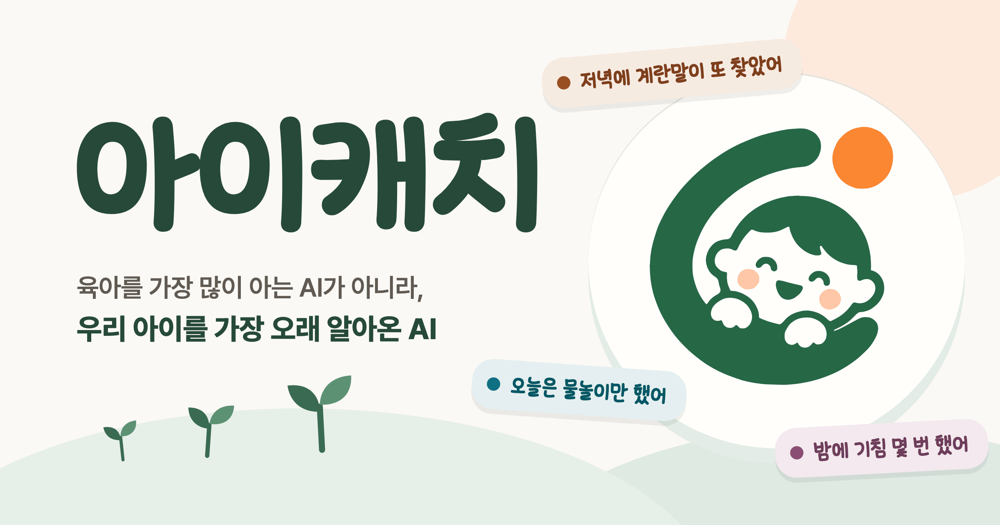
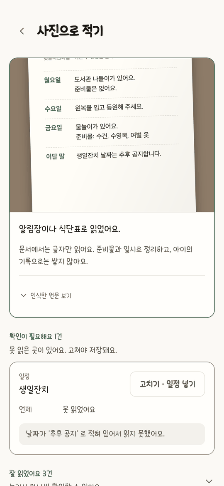
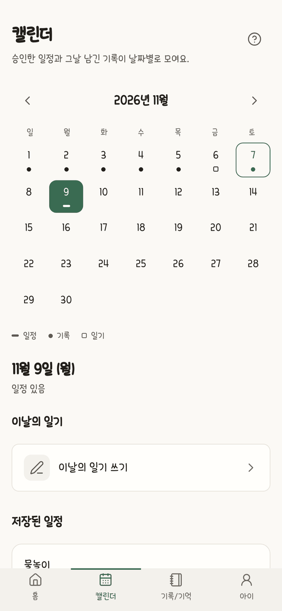
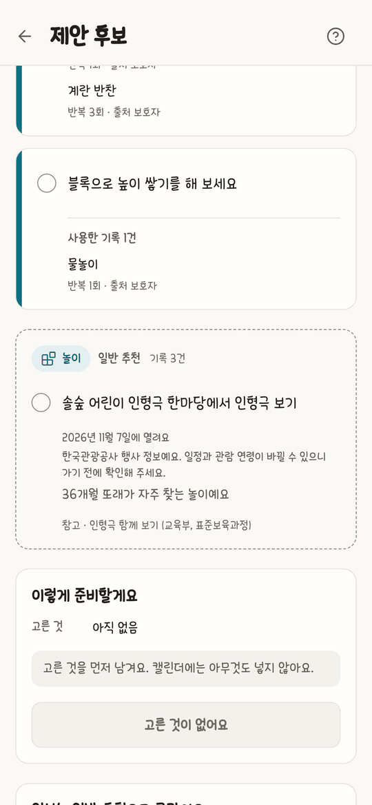

<div align="center">



**한 줄만 남기면, 우리 아이에게 맞는 다음 할 일로 돌아오는 육아 비서**

<a href="https://play.google.com/store/apps/details?id=kr.ai.icatch"></a>

[웹에서 바로 쓰기](https://icatch.ai.kr) · [소개 영상 (42초)](https://youtu.be/EAYOg7bfxaI) · [개발 문서](https://kakaotechcampus-4.github.io/ktc4-pusan-3/) · [API 문서](https://api.icatch.ai.kr/docs)

<sub>카카오테크 캠퍼스 4기 2단계 · 부산대 3팀</sub>

</div>

<!-- 시연 영상(제출물)이 올라오면 위 링크 줄의 "소개 영상" 뒤에 시연 영상 링크를 더한다 -->

## 육아 기록은 귀찮고, 적어도 돌아오는 게 없었습니다

아이 일은 매일 적을 게 생기는데, 기록 앱은 오래 쓰기 어렵습니다. 두 가지가 불편했습니다.

| | 불편 | 아이캐치는 |
| :---: | --- | --- |
| **적을&nbsp;때** | 식사 · 수면 · 건강 칸을 골라 항목을 하나씩 채워야 한다 | 가족에게 말하듯 **한 줄**만 남긴다. 나눠 담는 일은 AI 가 한다 |
| **적은&nbsp;뒤** | 기록이 쌓이기만 하고 쓸 데가 없다 | 쌓인 기록이 **우리 아이에게 맞는 추천**이 되어 돌아온다 |

보호자는 이미 매일 아이 이야기를 하고 있습니다. 배우자에게, 가족 채팅방에.
아이캐치는 새 습관을 요구하지 않고 그 한 줄을 받는 곳만 바꿉니다.
그리고 받은 한 줄을 근거로 저녁 메뉴 · 주말 놀이 · 일정 같은 다음 할 일을 준비해 둡니다.

## 한 줄이 추천이 되기까지

한 줄을 처음부터 끝까지 따라가 봅니다.

<table>
<tr>
<td width="250" align="center"></td>
<td>

**① 말하듯 한 줄 적습니다**

> 저녁에 계란말이 또 먹었어. 어젯밤엔 자다가 기침 몇 번 했어

칸을 고르지 않습니다. 식사인지 건강인지, 오늘 일인지 어제 일인지 나누지 않고 생각나는 대로 적습니다.

말로 해도 되고, 알림장이나 식단표는 사진으로 찍으면 됩니다.

</td>
</tr>
<tr>
<td width="250" align="center"></td>
<td>

**② AI 가 나눠서 저장합니다**

한 줄이 기록 두 건이 됐습니다. 계란말이는 오늘의 식사 기록으로, 기침은 어제의 건강 기록으로 들어갑니다.

그 아래 **"기억이 자랐어요"** 가 이 앱의 중심입니다. 계란 반찬을 찾은 날이 서로 다른 3일이 됐다는 뜻입니다.
한 번 적었다고 "계란을 좋아한다" 고 정하지 않습니다. 같은 날 세 번 적어도 하루로 셉니다.

</td>
</tr>
<tr>
<td width="250" align="center"></td>
<td>

**③ 기록이 추천으로 돌아옵니다**

저장 화면의 "오늘 저녁 같이 정하기" 를 누르거나 "오늘 저녁 뭐 해 주지?" 라고 적으면, 쌓인 기록에서 답을 찾습니다.

> 계란말이에 시금치를 조금 섞어 보세요

추천마다 **왜 이것인지**와 **어떤 기록을 썼는지**가 붙습니다. 이 카드는 기록 3건을 썼습니다.
적어 둔 것이 여기서 쓰입니다. 근거가 보이니, 틀린 추천은 틀렸다고 알아볼 수 있습니다.

</td>
</tr>
<tr>
<td width="250" align="center"></td>
<td>

**④ 중요한 것만 묻습니다**

적은 말에서 일정을 찾으면 초안을 만들어 보여 줍니다. 넣기 전까지는 캘린더에 들어가지 않습니다.

기록은 묻지 않고 바로 저장하고, 일정처럼 되돌리기 어려운 것만 확인을 받습니다.
확인이 많아지면 한 줄로 줄인 보람이 없기 때문입니다.

</td>
</tr>
</table>

<div align="center">

| 적기도 귀찮은 날에는 사진으로 | 지나간 날은 캘린더에서 |
| :---: | :---: |
|  |  |
| 알림장 · 식단표를 읽어 먼저 보여 주고<br>확인한 것만 저장합니다 | 승인한 일정과 그날의 기록이<br>날짜별로 모입니다 |

<a href="https://youtu.be/EAYOg7bfxaI"></a>
<br><sub>처음부터 끝까지 움직이는 모습은 소개 영상으로 (42초)</sub>

</div>

## 기록이 쌓일수록 추천이 달라집니다

적은 만큼 돌아와야 계속 적게 됩니다. 그래서 추천은 쌓인 기록에 따라 다르게 나갑니다.

<table>
<tr>
<td width="250" align="center"></td>
<td>

**기록이 아직 없을 때**<br>또래 기준의 일반 추천을 냅니다. 맞춤인 척하지 않습니다. 카드에 "일반 추천" 이라고 적고, 쌓인 기록 건수를 그대로 보여 줍니다.

**한두 번 적혔을 때**<br>근거로는 쓰지만 아이의 성향으로 정하지 않습니다.

**서로 다른 날에 반복됐을 때**<br>확정된 기억이 되어 추천의 근거로 먼저 쓰입니다.

**오래됐을 때**<br>6개월이 지난 관심은 혼자서는 근거가 되지 못합니다.

**보호자가 고쳤을 때**<br>"이번만 그랬어요" · "잘못된 기록" 에 따라 기억이 바뀝니다.

</td>
</tr>
</table>

## 그래도 AI 에게 맡기지 않은 것이 있습니다

저녁 메뉴는 틀려도 한 끼입니다. 알레르기와 일정은 그렇지 않습니다.
그래서 기능을 붙일 때마다 "이 일을 누가 하는가" 부터 정했습니다. 질문은 두 개입니다.


| 누가 | 무엇을 | 위의 한 줄에서는 |
| :---: | --- | --- |
| **사람** | 캘린더에 넣기 · 건강과 알레르기 기록 확정 · 대화로 지울 때의 삭제 확정 | Agent 는 일정 초안까지만 만든다. 승인 전에는 저장하지 않는다 |
| **코드** | 알레르기 필터, 날짜 · 나이 계산, 일정 충돌, 기억의 승격, 추천 근거의 순서 | 계란말이 추천은 알레르기 필터를 지난 뒤에만 나온다. 알레르기를 읽지 못하면 "없음" 으로 넘기지 않고 추천 없이 닫는다 |
| **LLM** | 한 줄에서 관찰 뽑기, 의도 분류, 식사 · 놀이 · 교육 후보 만들기 | 한 줄을 식사와 건강으로 나눈다. 기침은 적어 둘 뿐 무슨 병인지 말하지 않는다 |

> [!IMPORTANT]
> 진단하지 않습니다. 한 번의 관찰로 아이의 성향을 확정하지 않습니다. 근거가 없으면 일반 추천이라고 밝힙니다.

규칙 전체는 [CLAUDE.md §2 · §3](CLAUDE.md)에, 기록 저장에 왜 확인을 받지 않는지는 [설계 결정 §7](https://kakaotechcampus-4.github.io/ktc4-pusan-3/overview/decisions-v1/)에 있습니다.

## 어떻게 만들었나

### 한 줄이 지나가는 길


| 이렇게 만들었다 | 왜 |
| --- | --- |
| **저장이 검색보다 먼저** | 방금 저장한 기록이 같은 요청의 추천 근거로 잡혀야 한다. 그래서 백엔드와 AI 를 한 서비스로 묶었다 |
| **20초를 넘기면 부분 결과** | Agent 하나가 늦거나 실패해도 끝난 쪽은 먼저 보여 준다 |
| **성향은 규칙이 올린다** | 기억은 `candidate` 로 시작하고 반복 집계를 거쳐야 `confirmed` 가 된다. LLM 은 이 상태를 쓰지 못한다 |

Agent 별 설계 · 프롬프트 · 측정은 [개발 문서 사이트](https://kakaotechcampus-4.github.io/ktc4-pusan-3/)에 있습니다.

### 돌아가는 곳

<div align="center">


</div>


| 고른 것 | 왜 |
| --- | --- |
| 모바일은 **웹뷰 껍데기** | 화면이 두 벌이 되면 절대 규칙도 두 곳에서 지켜야 한다 |
| 벡터 DB 를 따로 두지 않고 **PostgreSQL 한 곳** | 여섯 명이 10주에 운영할 인프라는 적을수록 좋다 |
| 사진은 화면이 **S3 에 바로** 올린다 | 사진 본문이 API 서버를 거치지 않는다. 서버는 읽자마자 지운다 |
| 배포는 **OIDC + Systems Manager** | 저장소에 서버 열쇠를 두지 않는다 |

서버 구성과 운영 절차는 [배포 · 운영 문서](https://kakaotechcampus-4.github.io/ktc4-pusan-3/ops/deploy-v1/)에 있습니다.

## 만들면서 부딪힌 것

| 부딪힌 것 | 원인 | 한 일 | 결과 |
| --- | --- | --- | --- |
| 다시 누른 한 줄이 **두 번 저장**된다 | 저장은 됐는데 응답만 사라졌다 | `Idempotency-Key` 를 Redis 에 기억. Redis 가 죽으면 메모리로 넘기지 않고 503 | 같은 키 10번 → 저장 1건 |
| 같은 키가 **동시에** 오면 못 막는다 | 키 읽기와 쓰기가 따로였다 (워커 2개 실험에서 발견) | `SET NX` 한 번으로 합쳤다 | 동시 8개 × 300번, 중복 0 |
| **재배포** 중 요청이 502, 돌던 요청은 사라진다 | 컨테이너가 한 번에 하나만 뜬다 | 돌던 요청은 끝내고 내려가고, 새 요청은 프록시가 붙잡는다 | 110초 < 120초 < 150초로 맞물림 |
| 계란과 달걀을 **다른 것**으로 본다 | 임베딩 유사도가 뜻이 아니라 글자를 따라갔다 (0.20) | "같은 대상인가" 만 묻는 LLM 판정 | 유사도는 후보 추리기에만 |
| 긴 입력에서 **출력이 잘린다** | 1,000자부터 Supervisor 출력이 상한에 걸렸다 | 길이별로 재서 500자로 | 긴 글은 사진 읽기로 |

계기 · 비교 · 대가는 [설계 결정 9개](https://kakaotechcampus-4.github.io/ktc4-pusan-3/overview/decisions-v1/)와 [워커 2개로 돌려 본 기록](https://kakaotechcampus-4.github.io/ktc4-pusan-3/ops/workers-2-check-v1/)에 적었습니다.

## 정말 그렇게 움직이는지 쟀습니다

"근거를 단다" · "알레르기는 코드가 막는다" 는 말은 재 봐야 압니다. 실제 모델로 돌린 결과입니다.

<table>
<tr>
<td align="center" width="25%"><h3>8 / 10</h3><b>기획 때 정한 시나리오</b><br><sub>실제 모델 · 3회 모두 통과해야 통과</sub></td>
<td align="center" width="25%"><h3>0건</h3><b>절대 규칙 위반</b><br><sub>147 run 을 코드로 판정</sub></td>
<td align="center" width="25%"><h3>39 / 40</h3><b>장애 점검</b><br><sub>부품 10 × 장애 4 · make test 마다</sub></td>
<td align="center" width="25%"><h3>178 / 178</h3><b>급식표 메뉴 읽기</b><br><sub>사람이 확정한 정답 1장 · 1회</sub></td>
</tr>
</table>

실패한 2개의 원인은 [기준선 결과](eval/results/2026-11-10.md)에, 평가를 짠 방법은 [eval 문서](https://kakaotechcampus-4.github.io/ktc4-pusan-3/eval/eval-v1/)에, 남은 1칸은 [장애 점검표](eval/faults.md)에 있습니다.

> [!NOTE]
> **아직 못 한 것**
> - 서버는 한 대, 워커는 1개입니다. 상태를 DB 로 옮겨 늘릴 준비까지만 했습니다.
> - 10개 시나리오 중 2개가 통과하지 못했습니다 — 기록과 요청이 섞인 한 줄, 되묻기 답 이어받기.
> - 추천 카드의 채택 · 평가는 아직 아이의 성향에 반영되지 않습니다.
> - 복약 기록은 스토어 정책 때문에 닫아 두었고, Health Agent 는 추천 없이 기록과 안내만 합니다.

## 직접 돌려 보기

필요한 것: Docker · Python 3.12 + [uv](https://docs.astral.sh/uv/) · Node + pnpm

```bash
git clone https://github.com/kakaotechcampus-4/ktc4-pusan-3.git && cd ktc4-pusan-3

make db-up                                   # PostgreSQL(pgvector) + Redis
cp apps/api/.env.example apps/api/.env       # 모델 키 등을 채운다
make install && make db-migrate && make dev  # API → http://localhost:8000/docs

cp apps/web/.env.example apps/web/.env.local # 다른 터미널에서
make web-install && make web-dev             # 웹 → http://localhost:3000
```

백엔드 없이 화면만 보려면 `apps/web/.env.local` 에서 `NEXT_PUBLIC_API_MOCKING=enabled` 로 바꿉니다.

| 무엇을 검사하나 | 명령 | CI · 최근 30일 성공률 |
| --- | --- | :---: |
| API 단위 · 통합 · 장애 점검 | `make test` | [API CI](https://github.com/kakaotechcampus-4/ktc4-pusan-3/actions/workflows/ci-api.yml) · 96% |
| 웹 단위 · 화면 규칙 e2e | `make web-test` · `make web-e2e` | [Web CI](https://github.com/kakaotechcampus-4/ktc4-pusan-3/actions/workflows/ci-web.yml) · 96% |
| 웹 ↔ 서버 계약 | `make web-contract` | [Contract CI](https://github.com/kakaotechcampus-4/ktc4-pusan-3/actions/workflows/ci-contract.yml) · 100% |
| 실서버 e2e | `make web-e2e-live` | [Live E2E CI](https://github.com/kakaotechcampus-4/ktc4-pusan-3/actions/workflows/ci-e2e-live.yml) · 100% |
| AI 품질 (실제 모델) | `make eval` | 손으로 돌린다 |


배포가 도는 순서는 [배포 문서](https://kakaotechcampus-4.github.io/ktc4-pusan-3/ops/deploy-v1/)에 있습니다.

## 만든 사람들

<table>
<tr>
<td align="center" width="16%"><a href="https://github.com/jjaa0803"><br><b>박재형</b></a><br><sub>PM · 정책<br>API 일부</sub></td>
<td align="center" width="16%"><a href="https://github.com/tomchaccom"><br><b>김명성</b></a><br><sub>백엔드 · DB<br>배포</sub></td>
<td align="center" width="16%"><a href="https://github.com/nnhhlee"><br><b>이시하</b></a><br><sub>AI Agent<br>Supervisor · Memory 외</sub></td>
<td align="center" width="16%"><a href="https://github.com/03leedo"><br><b>이도헌</b></a><br><sub>AI Agent (Activity)<br>평가</sub></td>
<td align="center" width="16%"><a href="https://github.com/Hyeonsik-0"><br><b>오현식</b></a><br><sub>API<br>평가</sub></td>
<td align="center" width="16%"><a href="https://github.com/koty08"><br><b>고태영</b></a><br><sub>웹<br>모바일</sub></td>
</tr>
</table>

커밋 3,577개 · 머지된 PR 529개 · 멘토 리뷰 7회. 일하는 규칙은 [CONTRIBUTING.md](CONTRIBUTING.md)에, 여섯 명과 AI 코딩 도구가 함께 읽는 절대 규칙 · 용어는 [CLAUDE.md](CLAUDE.md)에 있습니다.

## 더 궁금하면

| 궁금한 것 | 여기 |
| --- | --- |
| Agent 를 어떻게 설계했나 | [개발 문서 사이트](https://kakaotechcampus-4.github.io/ktc4-pusan-3/) |
| 왜 그렇게 바꿨나 | [설계 결정 9개](https://kakaotechcampus-4.github.io/ktc4-pusan-3/overview/decisions-v1/) |
| 요구사항 · 데이터 모델 · 안전 설계 | [테크스펙](docs/overview/tech-spec.md) · [서비스 기획](docs/overview/service-plan.md) |
| API 는 어떻게 생겼나 | [Swagger](https://api.icatch.ai.kr/docs) — 서버 코드에서 만들어지는 계약 정본 |
| AI 품질을 어떻게 쟀나 | [eval 문서](https://kakaotechcampus-4.github.io/ktc4-pusan-3/eval/eval-v1/) · [결과](eval/results/2026-11-10.md) |

<sub>Google Play 및 Google Play 로고는 Google LLC 의 상표입니다.</sub>
