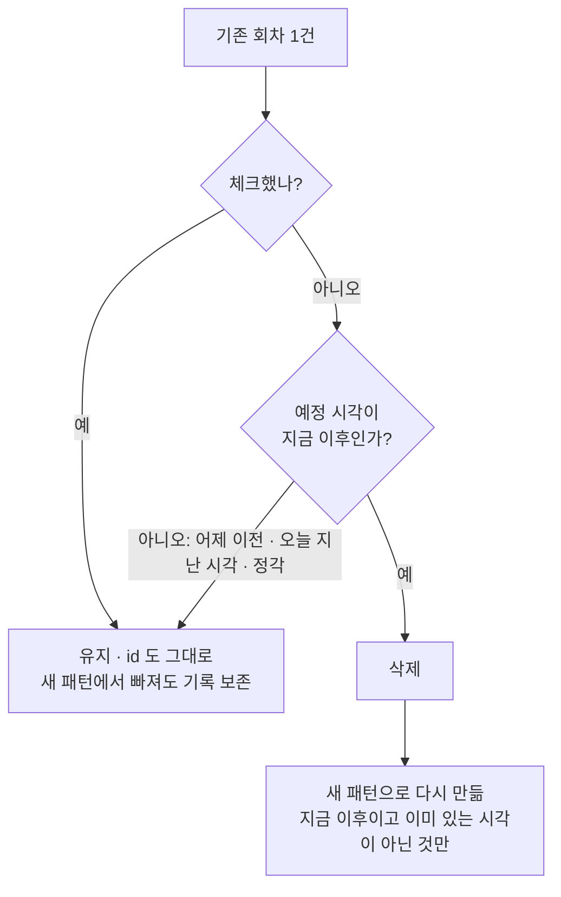

# 복약 API 계약 v4 (#563 합의 · 구현 반영)

이슈 [#577](https://github.com/kakaotechcampus-4/ktc4-pusan-3/issues/577) 의 API 4개에 대한 **케이스 · 순서 · 이유**를 적는다. 웹 [#563](https://github.com/kakaotechcampus-4/ktc4-pusan-3/pull/563) 에서 프론트 · BE · AI 가 합의한 계약을 그대로 따르고, 구현이 정한 세부(칸 규칙 · 에러 · 검사 순서)를 더했다.
선행: [`medication-tables-v1.md`](../medication/medication-tables-v1.md) (두 표 · §5 API 가 막을 것) · `docs/web/medication-v1.md` (#563 잠정 계약)

> 계약 정본은 Swagger 다 (루트 CLAUDE.md §5) — 칸의 뜻은 스키마의 `description` 에 있다. 이 문서는 Swagger 가 담지 못하는 **흐름 · 순서 · 이유**를 적는다.
> 칸 이름은 #563 `types.ts` 와 같고, 서버가 칸을 더하지 않는다.
> 상태: **구현됨** (`feat/be-577-medication-course-create`). 아직 정하지 못한 기준은 8절에 `잠정` 으로 모았다.

---

## 1. #563 에서 합의한 것

| 항목 | 합의 |
| --- | --- |
| 코스 등록 · 수정 | `POST` · `PATCH`, 승인 게이트 ㉡ 의 메서드. `Idempotency-Key` 필수 + 건강정보 동의. 알레르기(`health_safety`)와 같은 방식 |
| 회차 체크 | `PUT /children/{cid}/medication-doses/{did}/check { checked }`. 해제로 되돌릴 수 있어 **게이트가 아니고 키가 없다** |
| 조회 | `GET` 이 서버의 `today` 와 **오늘까지의 회차**를 싣고, 회차마다 `checkable` |
| 중복 | 같은 아이 · 같은 약 이름 · 같은 기간의 코스는 서버가 거절한다 (키가 다를 때). 같은 키는 처음 응답 재생 |
| 중단 | **화면에 중단 버튼도 API 도 없다.** Health Agent 가 대화에서 한 번 묻고 "네" 를 받으면 `status='stopped'` 로 쓴다 |

> v3 초안이 요청했던 경로 변경(`/medication-courses`)과 체크의 `PATCH` 전환은 **철회**했다. 경로는 #563 그대로다.

## 2. 용어

```
아이 (cid) ─ 코스 (sid) ─ 회차 (did)
```

- **코스** = 약 **1종**의 복용 계획. 예: "아목시실린 5ml, 10/27~10/29, 하루 3번 식후 30분". 약이 3종이면 코스 3건이고 동봉된 약도 코스 · 회차가 약마다 따로 생긴다. DB 표는 `medication_schedule` 이다.
- **회차** = 먹일 때마다 1행. 3일 × 하루 3번 = 9행. 체크 칸(`checked_at`)이 곧 복용 기록이다 (`medication_dose`).
- **시각 패턴** = 날짜 없는 하루 시각(`doses[]`). 서버가 기간의 날마다 펼쳐 회차를 만든다.

## 3. API 4개

| 하는 일 | 요청 | 키 | 동의 | 성공 |
| --- | --- | --- | --- | --- |
| 코스 등록 (게이트 ㉡) | `POST /children/{cid}/medications` | 필수 | 필요 | 201 `{ course }` |
| 코스 수정 (게이트 ㉡) | `PATCH /children/{cid}/medications/{sid}` | 필수 | 필요 | 200 `{ course }` |
| 진행 중 코스 조회 | `GET /children/{cid}/medications` | 없음 | 안 봄 | 200 `{ today, courses[] }` |
| 회차 체크 · 해제 | `PUT /children/{cid}/medication-doses/{did}/check` | 없음 | 필요 | 200 회차 |

## 4. 공통 규칙

- 에러 모양은 `{ "error": { "code", "message", "detail" } }`. 내 아이가 아니면 403 `child_access_denied`, 경로 uuid 형식 오류는 422, 인증이 없으면 401.
- **쓰기 검사 순서** — 앞에서 걸리면 아무것도 저장하지 않는다.

  | API | 순서 |
  | --- | --- |
  | 등록 | 접근 → 본문 형식 → 키 → 같은 키 재생 → 동의 → 내용 → 중복 → 저장 |
  | 수정 | 접근 → 본문 형식 → 키 → 같은 키 재생 → 동의 → **대상(404)** → 내용 → 체크한 회차 → 중복 → 저장 |
  | 체크 | 접근 → 본문 형식 → 동의 → **대상(404)** → 날짜(422) → 저장 |

- 건강정보 동의(`child_health`)는 **쓰기에서만** 확인한다. 조회는 동의가 없어도 200 이다.
- 같은 키 · **다른 본문**(422 `idempotency_key_reuse`)과 처리 중(409 `idempotency_in_progress`)은 서버가 **아직 내지 않는다**. 같은 키는 본문과 상관없이 처음 응답을 돌려준다.
- **동시 요청** — 같은 아이의 코스 등록 · 수정은 아이별 advisory lock(`pg_advisory_xact_lock`)으로 한 줄로 서서, 같은 코스를 동시에 보내도 하나만 저장되고 나머지는 409 다. 틀린 요청은 잠금을 잡기 전에 걸러진다. 회차 체크도 그 회차 행을 잠그고 읽는다 — 체크하는 동안 수정이 그 회차를 지웠다면 체크는 404 다.
- **시계** — 체크 · 수정은 지금과 한국 오늘을 시계 한 번으로 만든다 (자정을 넘는 순간 두 시계가 어긋나 이미 지난 날의 회차를 지우는 일을 막는다).
- 약 이름 · 칸 값은 **받은 그대로** 저장한다 (앞뒤 공백을 떼지 않는다). 선택 칸(`dosage` · `indication_text` · `note`)의 **빈 문자열만 `null`** 로 저장한다.

## 5. 등록 · 수정 요청 칸

수정은 `source` 가 없고 보호자가 확인한 **최종 상태 전체**를 보낸다 (부분 수정이 아니다). 길이는 글자 수(한글 1자 = 1)다.

| 칸 | 형식 | 비고 |
| --- | --- | --- |
| `source` (등록만) | `"utterance"` · `"prescription_ocr"` | 출처는 등록 때 정해져 바꿀 수 없다 — 수정에서 보내면 400 |
| `schedule.title` | 문자열, 필수 | 1~200자, 공백만이면 400 |
| `schedule.dosage` | 문자열 · `null` | 200자 이하 |
| `schedule.indication_text` | 문자열 · `null` | 500자 이하 |
| `schedule.note` | 문자열 · `null` | 1000자 이하 |
| `schedule.storage` | `"room"` · `"fridge"` · `null` | |
| `schedule.med_form` | `"liquid"` · `"powder"` · `"tablet"` · `"ointment"` · `"drops"` · `null` | |
| `schedule.symptom_codes` | 문자열 배열 | 화면이 고치지 않고 초안 값을 그대로 보낸다. 겹친 코드는 400(본문 형식), **사전에 없는 코드는 400(내용)** — 빈 코드도 사전에 없다. **수정은 이미 저장돼 있는 코드를 사전에서 빠졌어도 통과시키고 새로 들어온 코드만 거른다** (`core/symptom_codes.py`) |
| `schedule.starts_on` · `ends_on` | `YYYY-MM-DD`, 필수 | 끝 < 시작이면 400, **기간은 최대 90일**(끝 − 시작 + 1), 무기한 없음. 시작이 과거여도 되지만 지난 날짜의 회차는 만들지 않는다 |
| `doses[]` | 1~24개 | 같은 알림 시각이 둘이면 400 (anchor 가 달라도 계산한 시각이 같으면 같은 시각) |
| `doses[].timing_anchor` | `fixed` · `wake_up` · `breakfast` · `lunch` · `dinner` · `bedtime` | 기준 시각은 07:30 · 08:00 · 12:00 · 19:00 · 20:30 |
| `doses[].offset_minutes` | 정수 −120 ~ 180 | `fixed` 면 0. 식후 30분 = `30` |
| `doses[].fixed_time` | `"HH:MM"` · `null` | `fixed` 일 때만 값이 있어야 한다. 초 단위는 400 |

- 보내면 400 인 칸: `scheduled_time` · `draft_id` · `notice_times` · `missing` · `before` · 모르는 칸 전부.
- 알림 시각 = 기준 시각 + `offset_minutes` 이고 서버가 계산한다 (`breakfast` + 30분 = 08:30). 이 값이 곧 응답의 `notice_times` 다.

## 6. 응답 `course`

| 칸 | 형식 |
| --- | --- |
| `id` | 코스 id |
| `title` · `dosage` | 문자열 · 문자열/`null` |
| `starts_on` · `ends_on` | `YYYY-MM-DD` |
| `notice_times` | 하루에 울릴 시각 `["08:30","12:30","19:30"]`, 오름차순. **오늘 다음 날부터 첫 날의 패턴**이다 (없으면 마지막 날). 수정하면 지난 날의 회차는 옛 패턴으로 남으므로 모든 회차에서 모으지 않는다. 코스가 오늘 끝나고 오늘 회차 일부가 이미 지났으면 옛 시각이 섞일 수 있다 (예: 어제~오늘 `08:30`·`12:30`·`19:30` 코스를 09:40 에 `09:00`·`20:00` 으로 고치면 `["08:30","20:00"]`). Agent 의 `notice_times` 도 같은 규칙이다 |
| `doses[]` | **오늘까지**의 회차, (날짜, 시각) 순. 내일부터 먹는 코스는 빈 목록 |
| `doses[].id` · `dose_date` · `scheduled_time` · `checked_at` · `checkable` | 회차 id · `YYYY-MM-DD` · `"HH:MM"` · 시각/`null` · boolean |

`note` · `storage` · `med_form` · `indication_text` · `symptom_codes` 와 시각 패턴(`timing_anchor` 등)은 **저장은 하지만 응답에 주지 않는다**. `checkable` 은 오늘까지의 회차만 싣기 때문에 항상 `true` 다 (화면이 `false` 도 처리하므로 그대로 두면 된다).

## 7. 성공하면 / 실패하면

### 등록 `POST`

| 상황 | 응답 |
| --- | --- |
| "하루 세 번 식후" 3일 | **201** `{ course }`, 회차 9행, `course.doses` 는 오늘까지 |
| 같은 키로 다시 | 201, 처음 응답 그대로 (행이 늘지 않음) |
| 키 없음 | 400 `idempotency_key_required` |
| 본문 형식 오류 (모르는 칸 · 잘못된 enum · 날짜 · 겹친 증상 코드) | 400 `validation_failed` + `error.detail.fields` (예: `["schedule.starts_on"]`) |
| 내용 오류 (빈 약 이름 · 길이 초과 · 기간 90일 초과 · `doses` 0개 또는 25개 이상 · 같은 알림 시각 · `fixed` 조합 위반 · offset 범위 밖 · 사전에 없는 증상 코드) | 400 `validation_failed` + `fields` (예: `["schedule.title"]` · `["doses"]` · `["schedule.starts_on","schedule.ends_on"]`) |
| 기간 전체가 이미 지남 (`잠정`) | 400 `validation_failed`, `fields: ["schedule.ends_on"]` |
| 같은 아이 · 이름 · 기간의 진행 중인 코스가 있음 (`잠정`) | 409 `already_exists`. 멈춘 코스는 세지 않는다 |
| 동의 없음 | 403 `consent_required`, `detail.scopes: ["child_health"]` |

### 수정 `PATCH`

수정 때 서버는 **체크한 회차와 이미 지난 회차를 그대로 두고, 미체크이면서 예정 시각이 지금 이후인 회차만** 지우고 새 패턴으로 다시 만든다. 다시 만든 회차는 `id` 가 바뀌므로 화면은 응답의 `course` 로 갱신한다.



| 상황 | 응답 |
| --- | --- |
| 정상 | **200** `{ course }` — `notice_times` 는 새 패턴 |
| 같은 키로 다시 | 200, 처음 응답 그대로 |
| 없는 코스 · 남의 아이 코스 · **멈춘 코스** · **이미 끝난 코스**(마지막 날이 지남) | **404** `not_found` |
| 수정 뒤에도 남는 회차(**체크했거나 이미 지난 것**)가 **새 기간 밖**이 되는 수정 | 400 `validation_failed`, `fields: ["schedule.starts_on","schedule.ends_on"]` |
| 이 수정으로 다른 진행 코스와 이름 · 기간이 같아짐 (`잠정`) | 409 `already_exists`. 자기 자신 · 멈춘 코스와는 같아도 된다 |
| `source` 를 보냄 | 400 `validation_failed` |
| 그 밖의 400 · 403 | 등록과 같음 (길이 · 기간 상한도 같다) |

**불변식: 어느 회차든 `dose_date ∈ [starts_on, ends_on]` 이다** ([`medication-tables-v1.md`](../medication/medication-tables-v1.md) §5). 체크한 회차와 이미 지난 회차는 지우지 않으므로, 시작일을 그 뒤로 늦추는 수정은 400 이다 (끝일을 줄이는 것은 아직 안 온 회차만 지우니 된다).

다시 만들 때 **지금 이전의 시각은 만들지 않는다**. 등록은 오늘 회차를 통째로 만든다(방금 먹인 약을 등록하는 경우가 흔해서) — 둘이 다르다.

### 조회 `GET`

`today` 는 서버의 KST 오늘이다 (화면은 오늘을 따로 구하지 않는다).

| 상황 | 응답 |
| --- | --- |
| 진행 중 코스가 있다 | 코스마다 `notice_times` 와 **오늘까지**의 회차. 시작일 순, 같으면 만든 순 |
| 없다 | 200 `{ today, courses: [] }` |
| 멈춘 · 끝난 · 시작 전 코스 | 싣지 않음 (한계는 8절) |
| 동의 없음 | 그래도 200 (조회는 동의를 보지 않음) |

진행 중 = `active` 이고 시작일 ≤ 오늘 ≤ 끝일. 이 판정은 `models.in_progress` 한 곳이다.

### 체크 `PUT`

본문 `{ "checked": true | false }` (boolean 만 받는다). 게이트가 아니고, 같은 상태를 두 번 보내도 결과가 같다.

| 상황 | 응답 |
| --- | --- |
| 체크 / 해제 | **200** `{ id, dose_date, scheduled_time, checked_at, checkable }` (해제는 `checked_at: null`) |
| 이미 체크된 회차에 `true` 를 또 | 200, **처음 체크 시각 유지** |
| 체크하지 않은 회차를 해제 | 200, `checked_at: null` |
| **내일 이후 날짜의 회차** | **422** `dose_not_due` |
| 없는 회차 · 남의 아이 것 · **멈춘 코스에서 멈춘 뒤에 예정된 회차** | 404 `not_found` (멈춘 뒤에도 이미 남은 복용 기록은 그대로 둔다) |
| 멈춘 코스의 **멈추기 전에 예정된 회차** | **200** — 체크 · 해제된다. 멈춘 시각은 코스의 `updated_at`, 회차 시각은 한국 시간 `dose_date` + `scheduled_time`, 정각은 멈추기 전이다 (Agent 진료 준비가 "계획된 회차"로 세는 것과 같은 경계). 코스 내용 수정(`PATCH`)은 그대로 멈춘 코스를 404 로 막는다 |
| **마지막 날이 지난(끝난) 코스의 회차** | **200** — 체크 · 해제된다. 체크는 코스의 `status` 만 보고 날짜는 보지 않는다 (조회는 그 코스를 싣지 않는다) |
| 체크하는 동안 수정이 그 회차를 지움 (미체크 미래 회차) | 404 `not_found` — 500 이 아니다 |
| 동의 없음 | 403 `consent_required` |
| `checked` 가 없거나 boolean 이 아니거나 모르는 칸 | 400 `validation_failed` |

## 8. 확정한 것과 남은 것

### 확정

| | 결정 | 이유 |
| --- | --- | --- |
| 길이 상한 | `title` 200 · `dosage` 200 · `indication_text` 500 · `note` 1000 · 하루 `doses` 24 | 정상 입력이 거절되지 않게 넉넉히. `title` 은 일정 제출과 같고 `note` 는 일기 본문 1000자 선례(#549). 나머지는 선례 없는 제안값 |
| 기간 | 최대 90일, 과거 시작일 허용(지난 회차는 만들지 않음) | 코스는 처방 1건에 가깝다. 급성 질환은 5~10일, 오래 먹는 약도 1~3개월 단위로 처방한다(9절). 올리는 것은 쉽고 줄이는 것은 저장된 데이터와 부딪혀 어렵다 |
| 약 이름 | 받은 그대로 저장 | Agent 가 발화에서 뽑고 서버가 원문과 같은지 검증한 값이다 |
| 알림 시각 | 오늘 다음 날부터 첫 날의 패턴 (없으면 마지막 날) | 수정 뒤에도 지난 날의 회차는 옛 패턴으로 남아 모두 모으면 옛 시각이 섞인다 |
| 끝난 코스 수정 | 404 | 조회가 싣지 않는 코스다. 400(`ends_on`)으로 내면 고치지 않은 끝일이 틀렸다고 나온다. 시작 전 코스는 id 를 알면 고칠 수 있다 |
| 중단 | API 없음 | #563 합의 — Agent 가 대화에서 처리한다 |

### 잠정 (#563 에서 기준을 정하지 못해 구현이 임시로 정한 것)

| | 지금 동작 | 확인할 것 |
| --- | --- | --- |
| 기간 전체가 과거인 코스 | 400 | 거절이 맞는지 |
| 오늘 이미 지난 시각의 회차 | 등록은 만들고 수정은 안 만든다 | 두 경로를 같게 할지 |
| 중복의 기준 | 같은 아이 · **같은 약 이름(공백 · 대소문자 그대로)** · 시작일 · 끝일이 모두 같은 `active` 코스 | 공백 정규화 · 기간 겹침을 중복으로 볼지, 코드 이름 |
| 수정이 만드는 중복 | 거절 (자기 자신 · 멈춘 코스 제외) | 수정에도 적용할지 |

### 알려진 한계

- **시작 전 코스** — 내일부터 먹는 약을 오늘 등록하면 시작일 전까지 목록에 안 보인다 (id 를 알면 수정은 된다). 보호자가 등록이 안 됐다고 생각해 다시 등록하면 코스가 둘 생길 수 있다 (같은 내용 · 다른 키는 409 로 막지만 이름이 조금 다르면 막지 못한다).
- **끝난 코스** — 마지막 날이 지나면 목록에서 사라진다. 회차 id 를 아는 화면(마지막 날 밤에 열어 둔 화면)은 자정을 넘어서도 체크할 수 있지만(체크는 날짜를 보지 않는다), 목록에서 찾을 길이 없어 마지막 회차를 늦게 체크할 화면 경로가 없다.
- **긴 코스** — 조회가 오늘까지의 회차를 전부 주므로 90일 × 하루 3번이면 한 코스에 270개까지 늘어난다.
- **동시 요청은 DB 가 막지 않는다** — 같은 코스의 동시 등록 · 수정은 advisory lock 으로 직렬화해 하나만 저장한다(실제 동시 요청으로 확인). `health_safety` 처럼 DB 의 부분 고유 인덱스로 막는 것은 아니라서, 잠금을 거치지 않는 쓰기 경로가 생기면 다시 열린다. 고유 인덱스(마이그레이션)로 바꿀지는 후속.

### 후속 · 의견 요청

| | 내용 | 방향 |
| --- | --- | --- |
| 끝난 · 시작 전 코스 | 목록에 어떻게 보여 줄지 | 후속 이슈 (프론트 · PM) |
| 체크 · 확정한 보호자 | `medication_dose` 에는 `checked_at` 만 있고 누가 체크했는지가 없다 | 후속 (AI · PM). 필요하면 컬럼 추가와 응답 칸 추가가 따른다 |
| 동봉된 약 묶음 | 한 번에 체크하는 묶음 | 이번엔 약마다 체크. 처방전 경로(`source_draft_id`)와 함께 후속 |
| 90일을 넘는 코스 | 장기 복용 약 | 지금은 처방을 갱신할 때 새 코스로 이어서 등록. 필요하면 상한을 올리고 조회의 날짜 범위를 검토 |

## 9. 서버 스키마 ↔ 웹 타입 대응표 (웹 contract CI 용)

| 서버 스키마 | 웹 타입 |
| --- | --- |
| `SubmitMedicationRequest` | `SubmitMedicationBody` |
| `ReviseMedicationRequest` | 이름 있는 웹 타입이 없음 (`Omit<SubmitMedicationBody,"source">`) → 이름 있는 타입을 만들거나 대응표 `allow` 로 `source` 차이를 적는다 |
| `MedicationScheduleIn` · `MedicationDoseIn` | `SubmitMedicationBody["schedule"]` · `["doses"][number]` |
| `SubmitMedicationResponse` | `SubmitMedicationResponse` |
| `MedicationsResponse` | `MedicationsResponse` |
| `MedicationCourseOut` · `MedicationDoseOut` | `MedicationCourse` · `MedicationDose` |
| `CheckDoseRequest` | `CheckDoseRequest` |

## 10. mock 과 서버가 달라지는 동작

프론트가 mock 을 서버에 맞춘다.

| | mock | 서버 |
| --- | --- | --- |
| 시작일을 늦추는 수정 | 지난 회차를 그대로 둠 | **400** — 지난 회차가 기간 밖에 남기 때문 |
| 수정 시 오늘 회차 | 오늘 미체크 회차를 전부 다시 만듦 | **예정 시각이 지금 이후인 것만** (지난 시각의 새 회차를 만들지 않음) |
| 400 `detail.fields` | `["title"]` | `["schedule.title"]` |
| 약 이름 | `trim()` 해서 저장 | 받은 그대로 저장 (공백만이면 400) |
| 선택 칸의 빈 문자열 | 그대로 | `null` 로 저장 |
| 조회 | 아이의 코스 전부 | 진행 중만 |
| 내일 이후 체크 에러 | 422 `validation_failed` | 422 `dose_not_due` |
| 같은 코스를 다른 키로 | 코스가 둘 생김 | 409 `already_exists` |
| 알림 시각 | 회차에서 모음 | 오늘 다음 날부터 첫 날의 패턴 |

## 11. 참고

### 내부 문서 · 코드

- [`medication-tables-v1.md`](../medication/medication-tables-v1.md) — 두 표의 모양과 API 가 막을 것 (§5)
- 이슈 #537 — 표 설계 논의, PR #546(표) · #579(복약 DB 어댑터)
- `docs/web/medication-v1.md` (#563 잠정 계약) · `apps/web/src/lib/api/types.ts` · `apps/web/contract/` (웹 계약 대조)
- 선례 코드 — `routers/health_safety.py`(등록 · 수정 · 키 · 동의 · 409) · `routers/event_items.py`(체크) · `deps/child.py` · `errors.py` · `api/idempotency.py`

### 외부 근거 (기간 상한 90일)

의학적 판단 근거가 아니라 **제품 설계용 참고**다. 일부는 오래된 기사이고, 현행 고시 원문은 확인하지 못했다.

- 급성 중이염 항생제 5~10일: [연세대 학위논문(2004)](https://ir.ymlib.yonsei.ac.kr/bitstream/22282913/112061/1/T200400309.pdf) · [WikEM](https://wikem.org/wiki/Acute_otitis_media/ko)
- 소아 폐렴 5일 vs 10일: [PMC](https://www.ncbi.nlm.nih.gov/pmc/articles/PMC5469190/)
- 향정신성 의약품 1회 처방 급여 인정 원칙 30일, 불가피 시 최대 90일: [데일리팜](https://www.dailypharm.com/user/news/181677)
- ADHD 약(메틸페니데이트) 3개월 초과 처방 제한 기준, 개원가 처방은 1개월 단위가 흔함: [메디칼타임즈](https://medicaltimes.com/Mobile/News/NewsView.html?ID=1156782) (행정예고, 시행 확정은 확인 못 함)
- 소아 천식 흡입스테로이드는 장기 관리 · 주기적 재평가: [메디칼타임즈](https://medicaltimes.com/Mobile/News/NewsView.html?ID=1166057) (구체 기간 수치 없음)

## 미검증

- 웹 contract 대조(`compare.ts`)가 요청에는 있고 응답에는 없는 칸을 어떻게 판정하는지는 전체를 읽지 않아 모른다.
- 길이 상한 중 `dosage` · `indication_text` · `doses` 값은 선례 없는 제안값이다. 기간 상한 90일은 확인한 범위(9절)에 근거한 제안이고, **일반 약의 처방 일수 상한은 확인하지 못했다.**
- 프론트 쪽 내용은 #563 브랜치(머지 전) 기준이다.
